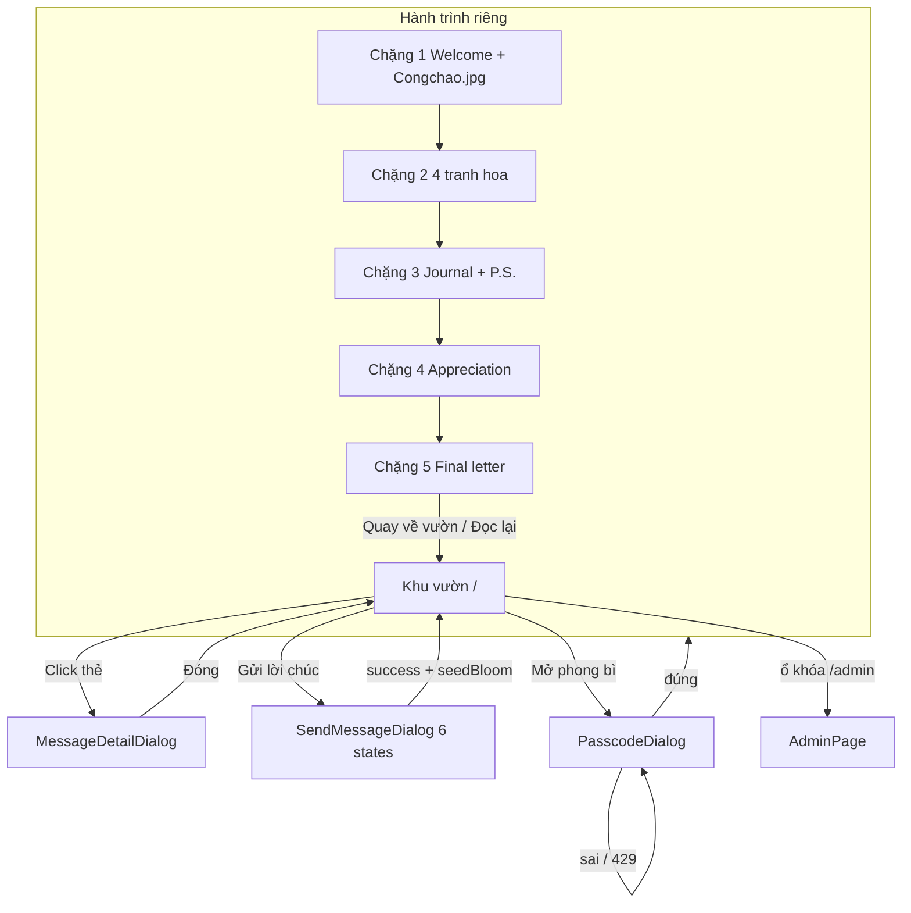

# PROJECT_CONTEXT.md — Bàn Giao Toàn Bộ Dự Án « Vườn Lời Chúc 20/10 »

> **Mục đích:** Đây là nguồn sự thật duy nhất (single source of truth) để một AI khác hiểu **toàn bộ** giao diện, hiệu ứng, luồng người dùng, kiến trúc kỹ thuật và ranh giới không được phá. Đọc file này trước khi mở code.
>
> **Ngày cập nhật:** 18/10/2026 (tăng hạt sáng hành trình: chặng 1 lên 10 sao ✦ cỡ 3.2–4.8rem; chặng 2–5 lên 20 hạt vàng cỡ 14–24px; nội dung chặng 2–5 đã biên tập lần 5; còn F3 (câu chữ) và chặng 3 mục 2 chờ xác nhận).
> **Cách xác minh:** Đối chiếu trực tiếp mã nguồn hiện tại (không phải bản mô tả cũ). Các mục đánh `[VERIFIED]` khớp với code tại thời điểm này.

---

## Cách AI tiếp theo nên dùng tài liệu này

1. Đọc mục **1 → 4** để nắm sản phẩm, route, cây file.
2. Đọc mục **5 → 7** trước khi đụng CSS: có **hai hệ thẩm mỹ** (Vườn công khai vs Hành trình riêng). Không trộn palette hồng đất của vườn vào hành trình, và ngược lại.
3. Đọc mục **10 + 15** trước khi sửa API / bảo mật / nội dung riêng tư.
4. **Không copy** nội dung lá thư từ `api/_privateData.ts` vào tài liệu công khai, commit message, hay UI công khai.
5. Không refactor ồ ạt. Đề xuất theo giai đoạn, giữ nguyên hợp đồng API và state machine đã ổn định.

---

## Mục Lục

1. [Project Overview](#1-project-overview)
2. [Executive Summary](#2-executive-summary)
3. [Project Structure](#3-project-structure)
4. [Route & Navigation Map](#4-route--navigation-map)
5. [UI Inventory & Visual Blueprint](#5-ui-inventory--visual-blueprint)
6. [Visual Design System](#6-visual-design-system)
7. [Motion & Interaction Inventory](#7-motion--interaction-inventory)
8. [Feature & State Inventory](#8-feature--state-inventory)
9. [Assets Inventory](#9-assets-inventory)
10. [Technical Architecture](#10-technical-architecture)
11. [Quality Audit](#11-quality-audit)
12. [Known Issues & Missing Pieces](#12-known-issues--missing-pieces)
13. [Recommended Improvement Opportunities](#13-recommended-improvement-opportunities)
14. [Verification Matrix](#14-verification-matrix)
15. [Handoff Guide for the Next AI](#15-handoff-guide-for-the-next-ai)

---

## 1. Project Overview

- **Tên dự án:** Vườn Lời Chúc 20/10 (package: `vuon-loi-chuc-20-10`).
- **Bối cảnh:** Website kỷ niệm Ngày Phụ nữ Việt Nam 20/10. Một khu vườn công khai để gửi/đọc lời chúc, cộng một **hành trình riêng tư 5 chặng** chỉ mở được bằng mật mã.
- **Đối tượng:**
  - **Công chúng:** xem thẻ lời chúc, gửi lời chúc (ẩn danh hoặc kèm tên).
  - **Người nhận phong bì:** nhập mật mã để đi 5 chặng cảm xúc và đọc lá thư.
  - **Admin:** `/admin` — ghim, ẩn, xóa, tìm kiếm, lọc.
- **Tinh thần thiết kế:** ấm, thơ, atmospheric. Không icon trái tim sến trên vườn công khai. Tôn trọng khoảng trống quanh cuốn sách phát sáng. Hành trình riêng dùng palette hoàng hôn màu nước (slate / peach / apricot), **không dùng đen thuần `#000`**.
- **Tech stack (đã đối chiếu `package.json`):**
  - React 18.3.1 + TypeScript ~5.6.2
  - Vite 6.x (`vite.config.ts` gắn middleware giả lập `/api/*` cho `dev` và `preview`)
  - CSS thuần + design tokens (`src/styles/tokens.css`, `global.css`)
  - `lucide-react` ^1.16.0
  - Vercel Serverless Functions trong `api/`
  - Supabase (`@supabase/supabase-js` ^2.118.0) + fallback in-memory khi thiếu env
- **Routing:** client-side nhẹ trong `App.tsx` (`/` ↔ `/admin` hoặc hash `#/admin`). Không dùng React Router.
- **Ngôn ngữ UI:** tiếng Việt, xưng hô thân mật « cậu / tớ » trong hành trình riêng.

---

## 2. Executive Summary

### Đã hoàn thiện [VERIFIED]

1. Vườn công khai: empty state, loading, 12 slot chữ V trên desktop, 8 slot tablet, grid nhỏ hơn trên mobile.
2. Carousel 18s khi > 12 lời chúc; pause khi hover; nút pause/play + chuyển thủ công.
3. Gửi lời chúc: state machine 6 bước, chuẩn hóa `\n`, giới hạn 3–300 ký tự, tên ≤ 40, `idempotencyKey`.
4. Passcode + rate limit 5 lần sai / khóa 30s (server IP + client lock).
5. Hành trình 5 chặng: Welcome (ảnh cổng), 4 tranh hoa + easter egg, sổ tay + P.S., 4 thẻ trân trọng, lá thư cuối.
6. Nền hành trình: `cad.jpeg` + kính mờ kem + tia nắng + hạt hoàng hôn.
7. Admin dashboard + Realtime (postgres_changes + broadcast hide/pin/delete).
8. Nội dung riêng tư chỉ nằm server-side `api/_privateData.ts` (file `_` không thành route). Frontend không import file này.
9. Ambience vườn: hào quang sách 7s, 7 hạt stardust, 24 hạt rơi SVG, vòng `seedBloom` khi gửi thành công.

### Còn mở (không phải bug chặn ship)

1. `public/coimay.png` chưa gắn vào UI.
2. Không có BGM / SFX.
3. `PlaceholderModal` còn file nhưng **không được import** — dead code.
4. `src/lib/supabaseClient.ts` có URL/anon key fallback hardcode khi thiếu `VITE_*` (anon key vốn public, nhưng nên ưu tiên env).

---

## 3. Project Structure

```
20thang10/
├── .env / .env.example
├── index.html                 # Fonts, favicon 🌸, OG image /nenpublic.jpg
├── package.json
├── tsconfig.json
├── vercel.json                # /api/(.*) + SPA fallback
├── vite.config.ts             # React + apiDevMiddleware
├── api/
│   ├── _privateData.ts        # [BẢO MẬT] payload 5 chặng — KHÔNG lộ ra frontend
│   ├── admin.ts
│   ├── public-messages.ts
│   └── unlock-journey.ts
├── public/
│   ├── nenpublic.jpg          # Nền vườn: sách phát sáng
│   ├── cad.jpeg               # Nền toàn hành trình riêng
│   ├── Congchao.jpg           # Hero Chặng 1 (cổng hoa)
│   ├── hoa1.jpg … hoa4.jpg    # Tranh Chặng 2
│   └── coimay.png             # Chưa dùng
├── supabase/schema.sql
└── src/
    ├── main.tsx
    ├── App.tsx
    ├── components/
    │   ├── ActionArea.*
    │   ├── FloatingMessageField.*
    │   ├── GardenAmbience.*
    │   ├── HeroSection.*
    │   ├── MessageCard.*
    │   ├── MessageDetailDialog.*
    │   ├── PlaceholderModal.*     # dead code
    │   ├── PrivateEnvelope.*
    │   ├── SendMessageDialog.*
    │   └── journey/
    │       ├── JourneyScenes.css
    │       ├── JourneyShell.*
    │       ├── PasscodeDialog.*
    │       └── scenes/
    │           ├── WelcomeScene.tsx
    │           ├── FlowerGardenScene.tsx
    │           ├── JournalScene.tsx
    │           ├── AppreciationScene.tsx
    │           └── FinalLetterScene.tsx
    ├── data/publicMessages.ts     # [] production + 12 demo local
    ├── lib/supabaseClient.ts      # Realtime browser client
    ├── pages/GardenPage.tsx, AdminPage.*
    ├── services/messageApi.ts, privateJourneyApi.ts
    ├── styles/tokens.css, global.css
    └── types/journey.ts, message.ts
```

### File nên đọc theo thứ tự

| Thứ tự | File | Vì sao |
| ---: | :--- | :--- |
| 1 | `src/styles/tokens.css` + `global.css` | Tokens vườn + lớp nền sách |
| 2 | `src/pages/GardenPage.tsx` | Orchestrator public |
| 3 | `src/components/FloatingMessageField.css` | 12 slot tuyệt đối |
| 4 | `src/components/GardenAmbience.tsx` + `.css` | Hạt rơi / seed bloom |
| 5 | `src/components/journey/JourneyShell.tsx` + `.css` | Palette + lớp nền hành trình |
| 6 | `src/components/journey/JourneyScenes.css` | Chi tiết 5 chặng |
| 7 | `api/_privateData.ts` | Copy chữ — **chỉ đọc, không đưa vào bundle client** |
| 8 | `api/public-messages.ts`, `unlock-journey.ts`, `admin.ts` | Hợp đồng API |

---

## 4. Route & Navigation Map

| Route / lớp | Component | Entry | Hành động |
| :--- | :--- | :--- | :--- |
| `/` | `GardenPage` | mặc định | xem thẻ, gửi lời chúc, mở phong bì, lock admin |
| `/admin` hoặc `#/admin` | `AdminPage` | ổ khóa góc phải hoặc URL | login, pin/hide/delete, search, filter |
| Overlay | `SendMessageDialog` | « Gửi một lời chúc » | 6 states |
| Overlay | `MessageDetailDialog` | click `MessageCard` | đọc full, ESC / X / backdrop |
| Overlay | `PasscodeDialog` | « Mở phong bì riêng » | passcode, eye toggle, Enter |
| Fullscreen overlay z-index 120 | `JourneyShell` | unlock thành công | 5 chặng, Về vườn, Tiếp tục |



**Quy tắc điều hướng hành trình (quan trọng):**

- Header chỉ còn **một nút trái** « Về vườn lời chúc » + 5 chấm tiến trình ở giữa. Không có nút phải trên topbar.
- Footer Chặng 1: **không** có « Chặng trước » (spacer trái). Nút phải nhãn **« Bước qua cánh cửa »**.
- Chặng 2–4: « Chặng trước » + « Tiếp tục ».
- Chặng 5: footer shell **ẩn nút Tiếp tục**; scene tự có « Đọc lại từ Chặng 1 » và « Quay về Vườn lời chúc ».
- Nút Tiếp tục **luôn mở sẵn** — không khóa theo puzzle. Click hoa / P.S. / easter egg là tùy chọn.
- `currentChapter` đổi → `scrollTo({ top: 0 })` trong content ref.
- Chặng 1 class `is-welcome`: content area không padding, không `translateX(4%)`. Chặng 2–5 desktop dịch nội dung **+4%** sang phải để cân bất đối xứng với nền `cad.jpeg`.

---

## 5. UI Inventory & Visual Blueprint

### 5.0 Phân lớp (stacking) — Vườn công khai

Từ sau ra trước (`GardenPage`):

| Lớp | Class / component | z-index | Việc làm |
| :--- | :--- | ---: | :--- |
| Body | `body` gradient ngang | — | Hồng `#F2D6E0` → kem `#FAF0E4` → mint `#E2F0EC` |
| Artwork | `.garden-background-artwork` | 0 | `/nenpublic.jpg` 1:1, neo đáy giữa, mask feather trái/phải/trên |
| Aura | `.garden-book-aura` | 1 | Radial vàng mật + hồng, blur 42–56px, pulse 7s |
| Top wash | `.garden-top-gradient` | 1 | Trắng 45% → trong suốt, cao 110px |
| Ambience | `.garden-ambience-layer` | (trên aura) | 7 stardust + 24 falling SVG + seed flare |
| App | `.garden-app` | 2 | flex column, **100dvh, overflow hidden** desktop |
| Hero | `.hero-section` | 20 | badge / title / subtitle |
| Field | floating field | 10 | slots / empty / loading |
| Dock | `.action-area-dock` | 30 | 2 CTA |
| Admin lock | `.garden-admin-quick-link` | 40 | 32px, top-right, opacity 0.55 |
| Modal | backdrop / content | 90 / 100 | dialogs |
| Journey | `.journey-shell-root` | 120 | phủ toàn màn |

Desktop `>= 861px`: vườn **không cuộn** (`height: 100dvh`). `<= 860px`: `.garden-app` height auto, body cuộn, mask artwork tắt.

---

### MÀN 1 — Vườn empty

- Hero:
  - Badge kính mờ pill: icon Sparkles sage + chữ hồng « Gửi trao yêu thương ».
  - H1 serif `clamp(2rem, 3.8vw, 2.7rem)`: « Vườn lời chúc ».
  - Subtitle italic serif hồng đất: « Một chút yêu thương cho ngày 20/10 ».
  - Mô tả muted: « Có những điều nhỏ bé cũng đủ làm một ngày trở nên dịu dàng hơn. »
- Loading: viên thuốc kính « 🌸 Đang đón gió vào vườn... » (hoa xoay 6s, pill thở 2.2s).
- Empty card: `max-width: 400px`, `margin: 1.5rem auto auto` (đẩy lên, **không che sách**). Icon Sparkles trong vòng `#FFF0F2`. Tiêu đề « Khu vườn đang chờ bạn ». Nút secondary « Xem thử bố cục 12 lời chúc » → nạp `devDemoMessages` **chỉ local, không ghi DB**.
- Dock viên thuốc `rgba(255,255,255,0.52)` blur 14px:
  - Primary hồng `#D48C94`, chữ trắng, Sparkles, hover nâng -2px + icon xoay 12°.
  - Divider 1px.
  - Secondary: Mail + « Mở phong bì riêng » + badge « Riêng tư ».
- Overlay hạt rơi luôn chạy (kể cả empty).

```
+------------------------------------------------------------------+
| [hồng]                                              [mint]  [🔒] |
|              🌸 Gửi trao yêu thương                              |
|                 Vườn lời chúc                                    |
|           Một chút yêu thương cho ngày 20/10                     |
|                                                                  |
|              +----------------------------+                      |
|   🌸 rơi     | ✨ Khu vườn đang chờ bạn   |     ⭐ rơi          |
|              | [Xem thử bố cục 12 lời chúc]|                     |
|              +----------------------------+                      |
|                     ☁️  sách phát sáng  ☁️                       |
|     (  [✨ Gửi một lời chúc] | [✉️ Mở phong bì riêng]  )        |
+------------------------------------------------------------------+
```

---

### MÀN 2 — 12 thẻ chữ V

**Desktop ≥ 980px:** 4 cột tuyệt đối, khe giữa trống cho sách.

| Slot | Cánh | Vị trí |
| ---: | :--- | :--- |
| 0, 2, 4 | trái ngoài | `left: 16px` — top 2% / 35% / 68% |
| 1, 3, 5 | trái trong | `left: 246px` — top 12% / 45% / 78% |
| 6, 8, 10 | phải ngoài | `right: 16px` — top 2% / 35% / 68% |
| 7, 9, 11 | phải trong | `right: 246px` — top 12% / 45% / 78% |

**861–979px:** 8 slot (ẩn 4,5,10,11), `left/right: 14px`.
**541–860px:** CSS grid nhiều cột.
**≤ 540px:** 1 cột, container hẹp.

**MessageCard:** max-width 220px, kính `rgba(255,255,255,0.72)` blur 8px, radius 14px. Header: chấm sage + tên hồng đất. Body 3 dòng `-webkit-line-clamp`. Footer « Đọc tiếp → ». Hover: scale 1.02, nâng -3px, viền hồng mềm. Pinned: viền hổ phách, icon `Pin` `#D97706` thay Feather.

**Carousel:** tin ghim luôn giữ slot; chỉ xoay unpinned mỗi 18s (`fieldFadeIn` 0.65s). Thanh pill: « Đang xem 12 / N » + Pause/Play + RefreshCw.

Demo mode: banner « 🌿 Bố cục 12 lời chúc thử nghiệm · Quay lại vườn gốc ».

Cache: `sessionStorage` key `vuon_public_messages_cache` — F5 không flash empty nếu đã có list.

---

### MÀN 3 — SendMessageDialog (6 states)

Overlay: `rgba(60,50,42,0.45)` blur 8px. Panel trắng radius 20px, max ~480px. ESC bị chặn khi `submitting`. Focus trap. `body.body-locked`.

| State | UI |
| :--- | :--- |
| `idle` | Tiêu đề « Gửi gắm yêu thương ». Tên ≤ 40. Checkbox ẩn danh khóa ô tên. Textarea kem, đếm `n/300`, cảnh báo từ 260. Nút « Xem trước lời chúc → » |
| `preview` | Mô phỏng MessageCard. « ← Sửa lại » / « Gieo vào khu vườn » |
| `submitting` | Khóa form, spinner |
| `success` | Mầm nở. Garden nhận message + `isSeedFlaring` 2.8s (`seedBloom`) |
| `error` | Retry giữ nguyên `idempotencyKey` |
| `uncertain` | Timeout 10s / 504 |

Hook test server: nội dung chứa `[test:error]` → 500; `[test:timeout]` → 504 lần đầu.

---

### MÀN 4 — MessageDetailDialog

Cùng overlay language. Hiện full `content` (giữ newline), tên theo `getSenderDisplayName` (ẩn danh / trống → « Một người bạn »). Đóng: ESC, X, backdrop. Trả focus về thẻ vừa click.

---

### MÀN 5 — PasscodeDialog

Phong bì cổ điển, con dấu sáp 60×60. Tiêu đề « Góc nhỏ riêng tư ». Input `letter-spacing: 0.15em`, Eye/EyeOff. Sai: viền ửng, câu tulip. 5 lần: 429 + countdown. Đúng: state `isUnlocking` rồi mount `JourneyShell`.

Passcode **không hardcode trên frontend**. Server: `PRIVATE_JOURNEY_PASSCODE` (fallback code `'2010'` nếu thiếu env) **hoặc** chuỗi `'tu-do'`. `.env.example` ghi `1412` — giá trị thật là env production, đừng giả định một số duy nhất khi review.

---

### MÀN 6 — JourneyShell (không gian riêng)

**Hai lớp thẩm mỹ hoàn toàn khác vườn.**

Stack:

1. `.journey-bg-cad` — `url('/cad.jpeg')` cover, `background-position: 25% center`, scale 1.04, inset -20px.
2. `.journey-frosted-overlay` — `rgba(250,247,242,0.55)` + backdrop blur (~5–20px) saturate 110%.
3. `.journey-sky-backdrop`:
   - sunbeams repeating-linear 128°, pulse 10s
   - sunburst radial đáy, pulse 8s
   - 20 hạt `.journey-sunset-particle` màu `#FFF6E0` / `#F5DFD3` / `#F7D8B5`, cỡ 14–24px (base 18px)
   - `.journey-paper-texture` noise ~3.5%
4. Topbar kính: nút « ← Về vườn lời chúc », 5 dots (upcoming peri / active scale 1.35 glow apricot / completed sage), chữ « Chặng n/5 ».
5. Main scroll.
6. Bottombar kem 86% blur 14px.

Vào shell: `journey-appear` 420ms fade+scale 0.985→1. Mỗi chapter: `chapterEntrance` 1s (blur 10px + translateY 24px) và `sceneLightSweep` 1.2s.

---

### Chặng 1 — WelcomeScene « Một cánh cửa nhỏ »

- Full-bleed `/Congchao.jpg`, mask fade đỉnh 0–15% để hòa vào `cad.jpeg`.
- `heroImgBreathe` 14s scale 1 → 1.035.
- Vignette hoàng hôn + sunburst blur 28px pulse 6s.
- 10 sparkle `✦` `#FFF6E0` `floatArchSpeck` 3.2s, cỡ 3.2–4.8rem (base 4.0rem), rải đều quanh cổng hoa.
- Title serif có text-shadow nắng. Subtitle pill kính (data.subtitle từ server).
- `.welcome-crystal-card` đáy: greeting / message / invitation — stagger `slideUpFade` 0.2s / 0.5s / 0.8s.
- **Không** còn icon sen Lucide; **không** badge « Chặng 1/5 » trong scene (đã nằm ở shell).

---

### Chặng 2 — FlowerGardenScene

Grid 2×2. Map ảnh:

| id | file | vai trò UI |
| :--- | :--- | :--- |
| `flower-1` | `/hoa1.jpg` | Sen — Bình yên |
| `flower-2` | `/hoa2.jpg` | Hướng dương — Niềm vui |
| `flower-3` | `/hoa3.jpg` | Hoa chuông — Khỏe mạnh (đổi nhãn từ « Can đảm » ngày 17/10/2026) |
| `flower-4` | `/hoa4.jpg` | Lavender — Khởi đầu mới |

Title/subtitle/message/color lấy từ `PrivateJourneyData.flowers` (server). Fallback icon Lucide nếu thiếu file.

Thẻ: kính kem, `cardFloat` 6s ±6px (chẵn delay -3s). Preview 96×96 `object-fit: contain`. Hover: pause float, scale 1.03, glow sunburst. Click: 8 hạt `✦` bung theo `--flower-theme-color` 0.8s; toggle đóng nếu click lại. Reveal card: ảnh 145×145 + halo thở 4s + badge + body + footer « Gửi tặng cậu một ngày thật dịu êm ». Auto `scrollIntoView`.

Easter egg: clover « Một nụ mầm nhỏ nép bên góc vườn », `eggPulse` 3s, reveal `eggBounce`.

---

### Chặng 3 — JournalScene

4 `.journal-card` số `01`… serif, hover nghiêng 3D (`rotateX/Y`, `preserve-3d`). Nút kẹp giấy: « Một ghi chú nhỏ (P.S.) » / « Gấp lại ghi chú nhỏ ». P.S. `psPaperFlip` 0.4s.

---

### Chặng 4 — AppreciationScene

Grid 4 thẻ: tag pastel, title, description. Hover nảy + inset glow `::after`.

---

### Chặng 5 — FinalLetterScene

`.letter-parchment` giấy kem. Title chào. Mỗi đoạn class `letter-p-0…` `paragraphStaggerFade` (blur → rõ). Signoff: wax seal Mail `waxSealPulse` 3s + date + signature italic. Hai CTA: secondary « Đọc lại từ Chặng 1 », primary « Quay về Vườn lời chúc ».

---

### MÀN 7 — AdminPage `/admin`

- Chưa login: card giữa, password `ADMIN_PASSWORD`, Eye toggle, « Quay về vườn ». Token `sessionStorage.garden_admin_token`.
- Dashboard: 4 KPI (tổng / hiển thị / ghim / ẩn) — MessageSquare / Eye / Pin / EyeOff.
- Tab All / Visible / Pinned / Hidden + search realtime + refresh.
- Mỗi hàng: tên, ẩn danh, datetime vi-VN, content, Pin, Hide, Delete (confirm).
- Realtime channel `admin_messages_realtime`. Garden channel `garden_public_messages_realtime` + broadcast `admin_toggle_hide` / `admin_delete` / `admin_toggle_pin`.
- Body **được cuộn** (không `overflow: hidden` trên admin).

---

## 6. Visual Design System

### 6.1 Tokens vườn (`tokens.css`) — chỉ dùng ngoài hành trình

**Nền:** `--color-bg-base #FAF7F2`, ivory `#FFFDF9`, card `#FFF`, glass `rgba(255,255,255,0.88)`.

**Accent:** primary `#D48C94`, soft `#E8B4B8`, hover `#C57780`, sage `#9CAF88`, sage-soft `#D1DEC7`.

**Chữ:** main `#4A4238`, muted `#7D7468`, light `#A49B8F`, on-accent `#FFF`.

**Viền:** `#F2E3DF`.

**Radius:** sm 8 / md 14 / lg 20 / full 9999.

**Shadow:** card ấm nâu-hồng; button `0 6px 18px rgba(212,140,148,0.35)`; modal `0 24px 60px rgba(74,66,56,0.22)`.

**Motion easing:** `--transition-fast 180ms`, normal 280ms, slow 450ms — cubic-bezier(0.16, 1, 0.3, 1).

**z:** background 0, field 10, header 20, action 30, modal 90/100. Journey **vượt tokens**: 120.

### 6.2 Palette hành trình (`JourneyShell.css :root`)

Không import tokens màu vườn cho scene. Dùng:

| Token | Hex | Vai trò |
| :--- | :--- | :--- |
| `--journey-sky-top` | `#BCCCE0` | trời |
| `--journey-sky-peach` | `#F5DFD3` | đào |
| `--journey-sky-apricot` | `#F7D8B5` | mơ |
| `--journey-sunburst-glow` | `#FFF6E0` | nắng |
| `--journey-sky-sage` | `#C7BEAC` | rêu khô |
| `--journey-text-title` | `#7E8F9F` | tiêu đề / CTA primary |
| `--journey-text-body` | `#6B6D70` | thân |
| `--journey-text-muted` | `#8C8C8C` | phụ |
| `--journey-card-bg` | `rgba(250,247,242,0.88)` | kính kem |

CTA primary hành trình: gradient `#7E8F9F → #687989`, chữ `#FAF7F2` — **không** dùng hồng đất `#D48C94`.

Cấm `#000000` trong journey.

### 6.3 Typography

- Serif: `'Cormorant Garamond'` 500/600/700 + italic 400 — hero, scene title, journal num, letter.
- Sans: `'Plus Jakarta Sans'` 400–700 — body, nút, form.
- Load: Google Fonts trong `index.html`.

### 6.4 Breakpoints

| Width | Vườn | Hành trình |
| :--- | :--- | :--- |
| ≥ 980 | 12 slot V | content `translateX(4%)` trừ welcome |
| 861–979 | 8 slot | — |
| 541–860 | grid, app cuộn | — |
| ≤ 540 | 1 cột, hero max 400px, dock padding đáy an toàn | ẩn spacer topbar |

`prefers-reduced-motion: reduce` — global + ambience + floating: tắt animation.

---

## 7. Motion & Interaction Inventory

| Phần tử | Trigger | Hiệu ứng | Kỹ thuật |
| :--- | :--- | :--- | :--- |
| Book aura | mount | thở opacity 0.65–1, scale 0.95–1.08 | `bookAuraPulse` 7s |
| Stardust ×7 | mount | bay lên từ gáy sách | `stardustRise` 8s |
| 24 falling | mount | petal/star/heart/flower/sparkle 3D | `fallSway*` / `fallStarTwinkle` / `fallHeartFloat` 11–13.8s |
| Seed bloom | gửi success | vòng hào quang nở 2.8s | `seedBloom` |
| MessageCard float | mount desktop | translate3d ±2–9px, rotate ±0.3° | `float-subtle-1/2/3` 6.2–8s |
| Card hover | hover/focus | pause float, scale 1.02 | CSS |
| Carousel | 18s / nút | fade canvas | `fieldFadeIn` |
| Loading pill | loading | thở + hoa xoay | `loadingPillBreath`, `spinFlowerSlow` |
| Modal | open | fade + scale up | `modal-fade-in`, `modal-scale-up` |
| Passcode burst | success path | hạt | `burstParticle` |
| Journey enter | unlock | fade scale | `journey-appear` 420ms |
| Chapter change | next/back | blur-in + light sweep | `chapterEntrance`, `sceneLightSweep` |
| Congchao | chặng 1 | Ken Burns nhẹ | `heroImgBreathe` 14s |
| Gate sparkles | chặng 1 | 10 ✦ bay xoay 3.2s, cỡ 3.2–4.8rem | `floatArchSpeck` |
| Sunset particles | chặng 2–5 shell | 20 hạt vàng 14–24px bay lên | `floatSunsetParticle`, `fireflyWander` |
| Crystal text | chặng 1 | stagger slide up | `slideUpFade` |
| Sunbeams / sunburst / particles | shell | pulse + float | 10s / 8s / 6.5–13s (20 hạt) |
| Flower cards | chặng 2 | float 6s, burst 8 sparkles | `cardFloat`, `flSparkleBurst` |
| Reveal | chọn hoa | pop + halo breathe + art float | `flowerRevealPop`, `haloBreathe`, `subtleArtFloat` |
| Egg | chặng 2 | pulse / bounce | `eggPulse`, `eggBounce` |
| Journal | hover | 3D tilt | transform preserve-3d |
| P.S. | toggle | lật giấy | `psPaperFlip` |
| Apprec | hover | nảy + inset glow | `::after` |
| Letter paras | mount | stagger blur fade | `paragraphStaggerFade` |
| Wax seal | mount | nhịp | `waxSealPulse` 3s |
| Admin lock | hover | scale 1.1, opacity 1 | CSS |
| Primary garden CTA | hover | -2px, sparkle rotate | CSS |

Không có Web Audio. Không có canvas particle — toàn CSS/SVG/DOM.

---

## 8. Feature & State Inventory

### Garden (`GardenPage`)

- `messages`, `isLoading`, `isDevDemoActive`, `isSeedFlaring`
- `selectedMessage` + `isDetailOpen`
- `isSendDialogOpen`, `isPasscodeOpen`
- `journeyData: PrivateJourneyData | null` — truthy ⇒ mount JourneyShell
- `activeTriggerEl` — trả focus a11y
- Sort: pinned trước, rồi `createdAt` mới → cũ
- Realtime INSERT/UPDATE/DELETE + 3 broadcast admin; **bỏ qua** khi demo local bật

### Send dialog

`idle → preview → submitting → success | error | uncertain`

Validate: content trim 3–300, name 40, ẩn danh bỏ tên. Idempotency UUID; regenerate khi user sửa draft; giữ khi retry.

### Passcode

`normal / verifying / unlocking / error / locked`

Delay UX ~600ms khi verify (trong dialog). Client lock đồng bộ từ 429.

### Journey

`currentChapter: 1..5`. Không persist (thoát = mất vị trí). Easter egg / P.S. / hoa active là local scene state.

### Admin

`token | null`, filter `all|visible|pinned|hidden`, `searchQuery`, `actionLoadingId`.

### Message model

```ts
PublicMessage {
  id, content, displayName: string | null,
  isAnonymous, isHidden?, isPinned?, createdAt
}
```

Ẩn danh hoặc tên trống → « Một người bạn ».

### Journey model (shape, không copy chữ)

`welcome { greeting, subtitle, message, invitation }`
`flowers: FlowerItem[]` (id, title, subtitle, iconName, message, color)
`easterEggFlower: FlowerItem`
`journal: JournalItem[]` (id, order, title, content)
`psNote { title, content }`
`appreciations: AppreciationItem[]` (category, title, description, tag)
`finalLetter { title, date, paragraphs[], signature }`

`iconName`: `'rose' | 'lotus' | 'sunflower' | 'tulip' | 'clover'`.

---

## 9. Assets Inventory

| File | Dùng ở | Ghi chú |
| :--- | :--- | :--- |
| `nenpublic.jpg` | `global.css`, OG image | Sách mở, bướm, mây — mask feather desktop |
| `cad.jpeg` | `JourneyShell.css` | Nền watercolor sunset toàn hành trình |
| `Congchao.jpg` | `JourneyScenes.css` Welcome | Cổng hoa, mask đỉnh |
| `hoa1.jpg`–`hoa4.jpg` | `FlowerGardenScene.tsx` | Tranh màu nước 2×2 |
| `coimay.png` | **chưa dùng** | Texture mây trong suốt |
| Favicon SVG 🌸 | `index.html` | data URI |
| Google Fonts | `index.html` | Cormorant + Jakarta |

`PlaceholderModal.*` tồn tại nhưng không nằm trong cây render.

---

## 10. Technical Architecture

### 10.1 API

```
GET  /api/public-messages     → list visible, pin-first, limit 100
POST /api/public-messages     → create { content, displayName, isAnonymous, idempotencyKey }
POST /api/unlock-journey      → { passcode } → { success, data: PrivateJourneyData }
GET  /api/admin?action=messages
POST /api/admin               login
PATCH/DELETE /api/admin       pin/hide/delete + Bearer token
```

Dev: `vite.config.ts` middleware parse JSON body và gọi thẳng handler.

Production: `vercel.json` rewrite `/api/(.*)` rồi SPA.

### 10.2 Hybrid DB

`getSupabaseClient()` dùng `SUPABASE_URL` + `SUPABASE_SERVICE_ROLE_KEY` hoặc `SUPABASE_ANON_KEY`. Thiếu / lỗi → `inMemoryMessages` + `inMemoryIdempotencyStore`. App không crash.

Bảng `public_messages`: uuid, content 3–300, display_name ≤ 40, flags, unique `idempotency_key`, RLS SELECT/INSERT/UPDATE/DELETE (policy rộng — **bảo vệ thật nằm ở service role trên API admin**, không phải RLS chặt). Realtime publication bật trong `schema.sql`.

Frontend `supabase` client: `VITE_SUPABASE_URL` / `VITE_SUPABASE_ANON_KEY` (có fallback trong `supabaseClient.ts`).

### 10.3 Bảo mật hành trình

- `api/_privateData.ts` prefix `_` → Vercel không tạo HTTP route.
- `src/` không import `_privateData`.
- Passcode so khớp server, lowercase trim.
- Rate limit **in-memory theo IP** (reset khi cold start serverless — hạn chế đã biết).
- Client timeout 8s GET list, 10s POST/unlock.

### 10.4 Env (`.env.example`)

```
SUPABASE_URL, SUPABASE_ANON_KEY, VITE_SUPABASE_URL, VITE_SUPABASE_ANON_KEY
SUPABASE_SERVICE_ROLE_KEY
PRIVATE_JOURNEY_PASSCODE
ADMIN_PASSWORD
```

Không commit `.env`.

### 10.5 A11y (đã làm)

- `lang="vi"`
- Focus visible 2px accent
- Modal: ESC, focus trap, restore trigger, `body-locked`
- `aria-expanded` hoa, `aria-live` reveal/egg/P.S.
- `prefers-reduced-motion`
- Admin lock `aria-label`

---

## 11. Quality Audit

**Điểm mạnh**

- Phân tầng vườn rõ: sách trung tâm không bị 12 thẻ che trên desktop.
- Hai thế giới màu (hồng-kem vs hoàng hôn slate) tách bạch sau khi gắn `cad.jpeg`.
- Motion chậm, so le, có nhánh reduced-motion.
- Optimistic UX: cache session, seed bloom, realtime không F5.

**Rủi ro thiết kế/kỹ thuật**

- Slot tọa độ cứng (px) — màn siêu rộng / siêu thấp có thể lệch.
- Frosted overlay hành trình: `backdrop-filter` vs `-webkit-backdrop-filter` **không cùng số blur** (5px vs 20px) — Safari/Chrome khác nhau.
- `background-attachment: fixed` trên `.journey-bg-cad` có thể giật iOS.
- RLS UPDATE/DELETE `USING (true)` — dựa vào việc client không gọi thẳng Supabase mutate (admin đi qua API + service role). Đừng đưa service role ra frontend.

---

## 12. Known Issues & Missing Pieces

| Mục | Chi tiết | Ảnh hưởng |
| :--- | :--- | :--- |
| `coimay.png` | Chưa mount | visual tùy chọn |
| BGM/SFX | Không có | cảm xúc |
| PlaceholderModal | Dead code | dọn được |
| Passcode fallback kép | env + `'2010'` + `'tu-do'` | nhớ khi đổi mật mã |
| Rate limit serverless | Map RAM theo instance | không chặt như Redis |
| Phablet dock | padding đáy đã có media 540px — vẫn canh safe-area nếu cần | UX điện thoại |
| Hardcoded supabase fallback | `supabaseClient.ts` | nên env-first |

Các hạng mục « thiếu tranh hoa / thiếu hạt rơi / mép tranh chữ nhật » **đã xong** — đừng làm lại từ zero.

---

## 13. Recommended Improvement Opportunities

Chỉ làm khi được yêu cầu, theo thứ tự gợi ý:

1. Gắn `coimay.png` lớp parallax rất mờ trên vườn hoặc journey — không che chữ.
2. Nút mute BGM góc vườn (piano/lofi), mặc định off, nhớ `localStorage`.
3. SFX lật trang khi đổi chặng (cùng mute).
4. Thống nhất blur overlay journey.
5. `env(safe-area-inset-bottom)` cho dock + journey footer.
6. Xóa `PlaceholderModal` nếu không cần.
7. Đưa supabase URL/key fallback ra env, bỏ hardcode.

**Không** tự ý:

- Đổi state machine 6 bước.
- Khóa nút « Tiếp tục » theo việc đã chọn hoa.
- Import `_privateData` vào `src/`.
- Thay 12-slot V bằng masonry che sách.
- Đổi CTA hành trình sang hồng đất (phá palette sunset).

---

## 14. Verification Matrix

| Hạng mục | Cách | Kỳ vọng |
| :--- | :--- | :--- |
| Build | `npm run build` | tsc + vite, 0 error |
| Bundle leak | search `dist/` chuỗi thư riêng | 0 hit |
| Empty garden | xóa cache + 0 message | empty card không che sách |
| Demo 12 | nút xem thử | 12 slot, không ghi DB |
| Carousel | >12 tin | 18s, pause hover |
| Send 6 states | form | preview, success, seed bloom |
| Passcode sai/đúng | dialog | tulip / vào chặng 1 cổng hoa |
| Journey nav | 1→5 | nhãn cửa chặng 1; chặng 5 không có Tiếp tục shell |
| Flower art | chặng 2 | 4 jpg + burst + reveal |
| Admin | `/admin` | KPI, pin/hide/delete, cuộn được |
| Realtime | 2 tab garden+admin | ẩn/xóa biến mất ~ngay |
| Reduced motion | OS setting | hạt/float dừng |
| Mobile 390 | DevTools | 1 cột, không overflow-x |

---

## 15. Handoff Guide for the Next AI

Bạn đang tiếp quản website 20/10 **đã đủ logic + backend + hành trình 5 chặng có artwork**. Nhiệm vụ mặc định là **Lead Product Designer / Creative Frontend**: tinh chỉnh cảm xúc, không đập nền tảng.

### Giữ nguyên

- Hợp đồng `/api/public-messages`, `/api/unlock-journey`, `/api/admin`
- `src/services/*` timeout + error mapping
- `_privateData.ts` chỉ server
- Nút tiến hành trình luôn sẵn
- 12-slot cánh + khe sách
- Hai palette: Garden tokens vs Journey sunset tokens

### Copywriting riêng tư

Nội dung chào, hoa, journal, P.S., appreciation, thư nằm trong `api/_privateData.ts`. Sửa chữ thì sửa file đó. **Không** nhúng vào component. **Không** dán nguyên văn vào README/PR.

### Hướng viết lại nội dung riêng tư (kim chỉ nam, cập nhật 17/10/2026)

Chỉ ghi **nguyên tắc và tiến độ** — không chép nguyên văn nội dung riêng tư vào đây.

**Kim chỉ nam:** đừng chỉ viết những điều tốt đẹp mà người nhận có thể muốn nghe; hãy viết để cô ấy hiểu vì sao người tặng muốn dành món quà này cho cô ấy.

**Hai lớp nội dung:**
- Lớp lời chúc: những điều bất kỳ người phụ nữ nào cũng xứng đáng nhận được trong ngày 20/10.
- Lớp riêng: lý do chọn cô ấy, chi tiết cụ thể đã khiến người tặng muốn làm món quà, cảm xúc của người tặng khi làm. Không cần nhồi chi tiết riêng vào mọi câu hay mọi chặng.

**Quy tắc viết:**
- Bắt đầu từ một quan sát hoặc cảm nhận **thật**, rồi mới đến lời chúc. Không bịa chi tiết để nghe sâu sắc; chỗ nào chưa có chất liệu thì viết giản dị.
- Phân biệt rõ sự kiện (điều có thật đã quan sát được) với cảm nhận của người tặng.
- Một điều cô ấy từng nói không đồng nghĩa đã hiểu hết con người cô ấy. Không biến nó thành kết luận về tính cách hay tổn thương bên trong.
- Viết từ vị trí người tặng, không viết như lời khuyên sống (tránh biến thành self-help thu nhỏ).
- Chất liệu công khai, đã thực sự để tâm: podcast cô ấy chia sẻ, cách kể chuyện đời thường, khoảnh khắc livestream, cách nói về tình yêu và cuộc sống.
- **Nguồn dữ kiện (đã xác nhận):** livestream game (ZingSpeed PC, đôi khi Audition), người tặng hay ghé xem và có vài tương tác nhỏ; có chia sẻ bài đăng và podcast — **podcast dùng giọng đọc AI**, không gọi là giọng của cô ấy và không nói cô ấy tự thu âm; có kể vài chuyện thường ngày trong livestream; từng công khai chia sẻ góc nhìn về tình yêu và cuộc sống (trên livestream rất ít). Không suy diễn tổn thương, cô đơn, tự ti, cần chữa lành, tìm kiếm tình yêu, mệt mỏi hay khó khăn; không gán phẩm chất (tinh tế, sâu sắc, dịu dàng, can đảm…) khi chưa có bằng chứng cụ thể.
- **Chi tiết thêm:** nếu muốn thêm một chi tiết về cô ấy, phải đánh dấu để người tặng xác nhận trước (comment `CẦN PHÁT XÁC NHẬN` trong `_privateData.ts`). Chưa có chi tiết chắc thì giữ câu chữ khái quát, trung thực.
- **Nhịp điệu:** mỗi đóa một trọng tâm và một kiểu kết riêng (lời chúc / điều muốn nói / cảm giác đọng lại / lời cảm ơn); không cho cả bốn kết bằng « Mong rằng… ». Tránh lặp « khoảng lặng », « dịu lại », « bình yên », « theo nhịp riêng », « những điều nhỏ bé » và ý gần nghĩa.
- **Sắc thái:** « cậu – tớ » nhất quán; dịu dàng, có tình cảm nhưng không phải lời tỏ tình, không giả vờ đã rất thân, không gây áp lực phải đáp lại. Dấu ấn cá nhân đến từ điều đã quan sát và cảm nhận, không từ việc khẳng định hiểu cô ấy đến đâu. Không khen tính cách chung chung.

**Thứ tự ưu tiên và tiến độ:**

| Ưu tiên | Hạng mục | Hướng | Trạng thái |
| ---: | :--- | :--- | :--- |
| 1 | Chặng 2 — bốn đóa hoa + hạt mầm bí mật | **Vai trò: lời chúc**, không phải quan sát (quan sát chuyển sang chặng 4). F1 chúc có lúc bình yên; F2 chúc niềm vui giản dị; F4 chúc, không giả định dự định, không áp lực. Hạt mầm: vui, tinh nghịch, không khen vô căn cứ | **Đã biên tập lần 5** — F3: nhãn « Khỏe mạnh » do người tặng chọn (thay « Can đảm »); câu chữ là đề xuất, **chờ xác nhận**, tránh giọng dặn dò; F1, F2, F4, hạt mầm đã xong |
| 2 | Chặng 3 — nhật ký + P.S. | Bốn suy ngẫm mở, mỗi mục một ý riêng, không giả định người nhận mệt/tự ti/cầu toàn. Mục 1 gom ba ý người tặng xác nhận (nghe podcast vì muốn nghe, xem live bình thường vẫn vui, quý một điều chưa vội gọi tên) thành một suy ngẫm « không cần mục đích » (kết bằng câu người tặng chọn). Mục 2 = « ở lại đến hết » (mới, chờ xác nhận). P.S. = « chọn đúng ngày 20/10 nhưng mở lúc nào cũng được » | **Đã biên tập lần 6** — mục 2 chờ xác nhận. Lưu ý: người tặng ở lại trọn phiên live và nghe đủ podcast, **không** viết kiểu « ghé qua rồi đi » |
| 3 | Chặng 4 — bốn thẻ trân trọng | Chỉ điều thật sự đã quan sát/nghe/trải nghiệm + cảm nhận của người tặng; category/tag nêu chủ đề, không gán phẩm chất | **Đã biên tập lần 4** — thẻ 3: đã cắt câu phòng thủ, không nêu thẳng quan điểm « không nhất thiết phải có tình yêu », dùng « biết đến » vì chưa rõ nguồn (người tặng đồng ý) |
| 4 | Chặng 5 — lá thư cuối | Bốn nhịp: cảm ơn đã đi hết hành trình → lý do tự làm món quà → lời chúc không cần phản hồi → dấu ấn người gửi | **Đã biên tập lần 5** — signature do người tặng chọn (« Người ghé qua từ phía bên kia màn hình » + 🌷); đoạn 4 đã xác nhận giữ; đã bỏ câu « không cần phản hồi » ở đoạn 3 |

**Phân vai giữa các chặng (chuẩn kiểm tra khi viết):**

| Chặng | Chức năng | Câu hỏi chính |
| :--- | :--- | :--- |
| 2 | Gửi lời chúc | Mong cô ấy có điều gì trong 20/10 và thời gian sắp tới? |
| 3 | Suy ngẫm có thể giữ lại | Có suy ngẫm dịu dàng nào cô ấy có thể mang theo cho riêng mình? |
| 4 | Ghi nhận cá nhân | Đã thực sự quan sát, ghi nhớ và trân trọng điều gì? |
| 5 | Khép lại + dấu ấn | Vì sao làm món quà này, và sau cùng muốn gửi điều gì? |

Đã chuyển quan sát podcast/chuyện thường ngày/góc nhìn/livestream từ chặng 2 sang chặng 4 để tránh trùng. File `_privateData.ts` có khối ghi chú đầu file nêu dữ kiện đã xác nhận và dòng nhãn `[CẦN XÁC NHẬN]`.

Hoãn: chuyển cảnh và animation — giao diện hiện đã đủ chất thơ, không thêm hiệu ứng chỉ vì có thể thêm.

**Lưu ý kỹ thuật:** chỉ nội dung chữ trong `api/_privateData.ts` thay đổi; interface `PrivateJourneyData` và hợp đồng `/api/unlock-journey` giữ nguyên. Với chặng 2, nhãn `title`/`subtitle` của hoa vẫn là chủ đề (Bình yên, Niềm vui, Can đảm, Khởi đầu mới); ảnh `hoa1–hoa4.jpg` map theo `id` nên không bị ảnh hưởng.

### Checklist trước khi kết luận một thay đổi UI

1. Desktop 1440: sách còn thấy rõ?
2. Mobile 390: dock không đè nội dung, không phình ngang?
3. Empty + 12 demo + >12 carousel?
4. Gửi lời chúc còn seed bloom?
5. Unlock → chặng 1 còn Congchao + crystal card?
6. Chặng 2 còn 4 tranh + easter egg?
7. `prefers-reduced-motion` chưa bị phá?
8. `dist/` sau build vẫn sạch thư riêng?

### Giọng điệu khi thêm UI copy

Nhẹ, cụ thể, không sến, không quá nhiều emoji. Vườn: « cậu » trung tính. Hành trình: thân mật đã có sẵn từ data server.

---

*Hết tài liệu bàn giao. Mọi mô tả UI/hiệu ứng ở trên khớp mã nguồn ngày 18/10/2026.*