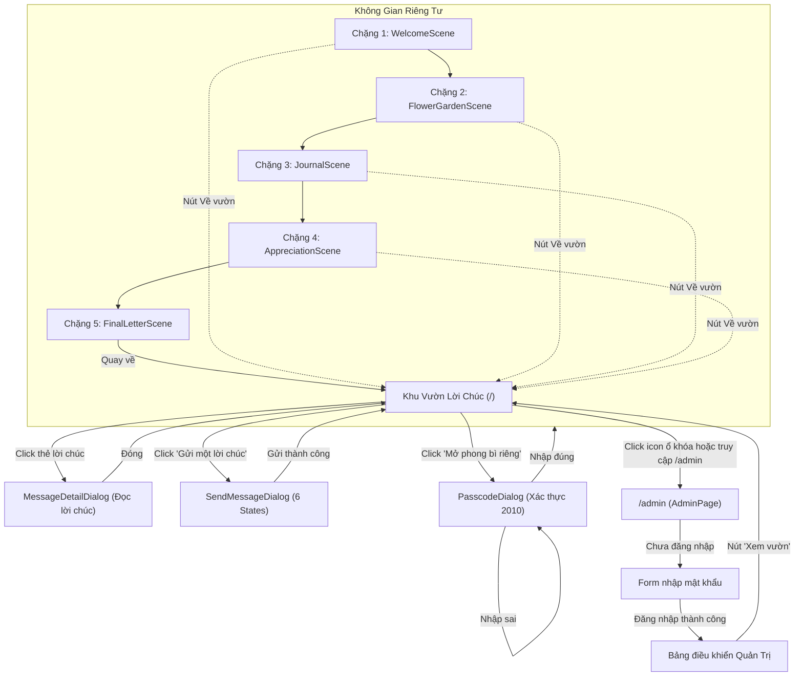

# PROJECT_CONTEXT.md — Tài Liệu Ngữ Cảnh & Kiểm Kê Dự Án Website 20/10

> **Mục đích tài liệu:** Bàn giao toàn bộ hiện trạng kỹ thuật, cấu trúc giao diện, hệ thống thẩm mỹ, animation và trải nghiệm người dùng của dự án **"Vườn Lời Chúc 20/10"** cho AI reviewer / Designer / Frontend Architect để thực hiện đánh giá UX/UI, phân tích visual & motion, và đề xuất nâng cấp thẩm mỹ.
> **Ngày thực hiện audit:** 16/10/2026.
> **Trạng thái mã nguồn:** Nguyên trạng, không chỉnh sửa code sản phẩm trong quá trình lập tài liệu.

---

## Mục Lục

1. [Project Overview](#1-project-overview)
2. [Executive Summary](#2-executive-summary)
3. [Project Structure](#3-project-structure)
4. [Route & Navigation Map](#4-route--navigation-map)
5. [Current UI Inventory & Visual Blueprint (Không Cần Chụp Màn Hình)](#5-current-ui-inventory--visual-blueprint-không-cần-chụp-màn-hình)
6. [Visual Design System](#6-visual-design-system)
7. [Motion & Interaction Inventory](#7-motion--interaction-inventory)
8. [Feature & State Inventory](#8-feature--state-inventory)
9. [Assets Inventory](#9-assets-inventory)
10. [Technical Architecture](#10-technical-architecture)
11. [Quality Audit](#11-quality-audit)
12. [Known Issues & Missing Pieces](#12-known-issues--missing-pieces)
13. [Recommended Improvement Opportunities](#13-recommended-improvement-opportunities)
14. [Verification Matrix](#14-verification-matrix)
15. [Handoff Guide for the Next AI](#15-handoff-guide-for-the-next-ai)

---

## 1. Project Overview

- **Tên dự án:** Vườn Lời Chúc 20/10 (Tên gói package: `vuon-loi-chuc-20-10`).
- **Bối cảnh & Mục tiêu:** Ứng dụng web kỷ niệm Ngày Phụ nữ Việt Nam 20/10. Tạo ra một không gian mở dịu dàng để mọi người gửi gắm lời chúc chân thành đến phái đẹp, đồng thời tích hợp một "Hành trình riêng tư" (Private Journey) bí mật mở bằng mã số dành riêng cho một người đặc biệt.
- **Đối tượng sử dụng:**
  - *Người dùng đại chúng (Public):* Ghé thăm vườn hoa, đọc những lời chúc trôi nổi, gửi lời chúc mới (ẩn danh hoặc kèm tên).
  - *Người nhận phong bì riêng (Private):* Nhập mật mã riêng tư để mở cánh cửa 5 chặng tương tác cảm xúc và đọc lá thư tay.
  - *Quản trị viên (Admin):* Truy cập `/admin` bằng mật khẩu để kiểm duyệt nội dung, ẩn tin spam và ghim lời chúc nổi bật.
- **Tinh thần thiết kế (Design Tone & Mood):** Ấm áp, dịu êm, giàu chất thơ (poetic & atmospheric). Sử dụng bảng màu kem ấm (`#FAF7F2`), hồng phấn đất (`#D48C94`), xanh xô thơm (`#9CAF88`), kết hợp font có chân cổ điển `Cormorant Garamond` và font không chân hiện đại `Plus Jakarta Sans`. Không lạm dụng icon trái tim sến sẩm, tôn trọng khoảng lặng và ánh sáng phát ra từ cuốn sách trung tâm.
- **Tech Stack đã xác minh:**
  - Core: React 18.3.1 + TypeScript ~5.6.2 (Bundler mode).
  - Build Tool: Vite 6.4.4.
  - Styling: Pure CSS Modules / Vanilla CSS với biến Design Tokens (`tokens.css`, `global.css`).
  - Icons: `lucide-react` (v1.16.0).
  - Backend & Serverless: Vercel Serverless Functions (`/api/*`).
  - Database & Auth: Supabase PostgreSQL (`@supabase/supabase-js` v2.49.1) với Row Level Security (RLS) và cơ chế In-Memory Hybrid Fallback khi dev local.
- **Trạng thái tổng thể hiện tại:** Đã hoàn thiện toàn bộ tính năng cốt lõi (Milestone 1, 2, 3, 4 + Admin Dashboard). Sẵn sàng deploy production.

---

## 2. Executive Summary

- **Những gì đã hoạt động hoàn chỉnh [VERIFIED]:**
  1. Khu vườn công khai hiển thị tối đa 12 thẻ lời chúc dạng 2 cánh chữ V trên Desktop và 1 cột thẻ căn giữa trên Mobile.
  2. Cơ chế tự động xoay vòng (Carousel) mỗi 18 giây khi số lượng lời chúc > 12, hỗ trợ tạm dừng khi rê chuột và nút chuyển thủ công.
  3. Luồng "Gửi một lời chúc" với State Machine 6 trạng thái (`idle` → `preview` → `submitting` → `success` / `error` / `uncertain`), hỗ trợ chuẩn hóa ký tự, giữ nguyên `\n` và chống trùng lặp `idempotencyKey`.
  4. Hộp thoại nhập passcode phong bì riêng với Rate Limit (5 lần sai = khóa 30 giây).
  5. Hành trình riêng 5 chặng độc lập với 4 bông hoa tương tác, nụ mầm may mắn (Easter Egg), 4 trang sổ tay, ghi chú P.S., 4 quan sát tinh tế và Lá thư cuối hoàn chỉnh.
  6. Backend Vercel Serverless Functions (`/api/public-messages`, `/api/unlock-journey`, `/api/admin`) hoạt động ổn định ở cả môi trường kết nối Supabase thật và chế độ In-Memory.
  7. Trang Quản trị viên (`/admin`) đầy đủ thống kê, tìm kiếm, lọc tab, Ghim (Pin), Ẩn (Hide) và Xóa (Delete).
  8. Bảo mật Frontend Bundle: 100% nội dung riêng tư nằm ở server file `api/_privateData.ts`, hoàn toàn không lọt vào `dist/`.
- **Những gì còn thiếu hoặc là cơ hội nâng cấp thị giác:**
  1. Các file ảnh tĩnh trong `public/` (`hoa1.jpg` đến `hoa4.jpg`, `Congchao.jpg`, `coimay.png`) chưa được gắn vào giao diện, Chặng 2 hiện chỉ dùng vector icon Lucide thay vì hình vẽ hoa chân thực.
  2. Chưa có hiệu ứng âm thanh nền nhẹ nhàng (BGM / Ambient Sound) hoặc hiệu ứng cánh hoa rơi tự nhiên (Canvas Particle Effects).
  3. Giao diện Desktop của khu vườn đang cố định `height: 100dvh` nên khi số thẻ ít hoặc nhiều, việc phân bố vị trí dựa vào tọa độ phần trăm tĩnh (`top`, `left`, `right`) có thể cần thêm độ ngẫu nhiên sinh động.
- **3 Vấn đề đáng chú ý nhất phát hiện qua Audit:**
  - *Vấn đề 1 (Đã fix trong đợt audit trước):* Thuộc tính `overflow: hidden` trên `body` từng làm kẹt thanh cuộn trang Admin; hiện đã được dọn sạch về `overflow-y: auto`.
  - *Vấn đề 2:* Dữ liệu hiện tại đang ở trạng thái rỗng 100% (Production Clean), cần người dùng gửi lời chúc thật hoặc chạy SQL hạt giống nếu muốn demo có sẵn dữ liệu.
  - *Vấn đề 3:* Bố cục phablet (412px–440px) cần tiếp tục giám sát vùng đệm ActionArea để các nút bấm không sát mép thanh điều hướng dưới cùng của hệ điều hành di động.
- **Giới hạn của cuộc audit:** Kiểm tra trực quan dựa trên Chrome DevTools browser session runtime trên Vite Preview (port 4173) và đối chiếu trực tiếp mã nguồn. Không can thiệp DB Supabase từ xa để tôn trọng tính toàn vẹn dữ liệu của người dùng.

---

## 3. Project Structure

### Cây thư mục dự án
```
20thang10/
├── .env                          # Biến môi trường local (SUPABASE_URL, PASSCODE, ADMIN_PASSWORD)
├── .env.example                  # Mẫu cấu hình môi trường chuẩn
├── .gitignore                    # Bảo vệ .env, node_modules, dist
├── index.html                    # Entry point HTML, load Google Fonts & favicon hoa anh đào
├── package.json                  # Cấu hình dự án & dependencies
├── tsconfig.json                 # Cấu hình TypeScript compiler (Bao gồm types node, api, src)
├── vercel.json                   # Cấu hình Vercel Serverless rewrite /api/(.*) và SPA
├── vite.config.ts                # Vite config tích hợp API middleware giả lập cho dev/preview
├── api/                          # Backend Vercel Serverless Functions
│   ├── _privateData.ts           # [BẢO MẬT] Dữ liệu 5 chặng Hành trình riêng (không lộ thành route)
│   ├── admin.ts                  # API Admin: Login, messages, update (pin/hide), delete
│   ├── public-messages.ts        # API Public: GET danh sách (ưu tiên ghim), POST gửi lời chúc
│   └── unlock-journey.ts         # API Unlock: Kiểm tra passcode, IP rate limiting
├── public/                       # Static Assets
│   ├── Congchao.jpg              # Ảnh cổng chào (asset dự phòng)
│   ├── coimay.png                # Asset khói mây trang trí
│   ├── hoa1.jpg -> hoa4.jpg      # 4 ảnh hoa nghệ thuật (asset dự phòng)
│   └── nenpublic.jpg             # Ảnh nền chính của khu vườn (cuốn sách phát sáng trung tâm)
├── supabase/
│   └── schema.sql                # SQL Schema tạo bảng public_messages, RLS & chỉ mục
└── src/
    ├── main.tsx                  # React DOM mount entry point
    ├── App.tsx                   # Client-side routing nhẹ giữa GardenPage và AdminPage
    ├── components/               # Các UI components chính
    │   ├── ActionArea.tsx / .css           # Thanh nút bấm dưới chân trang ("Gửi lời chúc", "Mở phong bì")
    │   ├── FloatingMessageField.tsx / .css # Vùng thẻ lời chúc trôi nổi 12 slots + Carousel 18s
    │   ├── HeroSection.tsx / .css          # Tiêu đề vườn hoa & lời dẫn nhập
    │   ├── MessageCard.tsx / .css          # Thẻ lời chúc công khai (hỗ trợ badge Ghim ⭐)
    │   ├── MessageDetailDialog.tsx / .css  # Hộp thoại đọc chi tiết lời chúc
    │   ├── PlaceholderModal.tsx / .css     # Modal placeholder (đã được thay thế hoàn toàn)
    │   ├── PrivateEnvelope.tsx / .css      # Nút phong bì phong cách cổ điển
    │   ├── SendMessageDialog.tsx / .css    # Modal gửi lời chúc (State machine 6 bước)
    │   └── journey/                        # Module Hành trình riêng 5 chặng
    │       ├── JourneyScenes.css           # Styling chi tiết cho cả 5 chặng
    │       ├── JourneyShell.tsx / .css     # Khung điều hướng, progress 5 chấm, thanh header/footer
    │       ├── PasscodeDialog.tsx / .css   # Hộp thoại nhập mật mã mở phong bì
    │       └── scenes/
    │           ├── WelcomeScene.tsx        # Chặng 1: Một cánh cửa nhỏ
    │           ├── FlowerGardenScene.tsx   # Chặng 2: 4 đóa hoa tương tác + Nụ mầm Easter Egg
    │           ├── JournalScene.tsx        # Chặng 3: 4 trang sổ tay + Ghi chú P.S.
    │           ├── AppreciationScene.tsx   # Chặng 4: 4 quan sát chân thành
    │           └── FinalLetterScene.tsx    # Chặng 5: Bức thư tay hoàn chỉnh
    ├── data/
    │   └── publicMessages.ts     # Danh sách tin nhắn khởi tạo (hiện để [] cho production)
    ├── pages/
    │   ├── GardenPage.tsx        # Trang chủ khu vườn công khai
    │   ├── AdminPage.tsx / .css  # Trang Dashboard quản trị viên (/admin)
    ├── services/
    │   ├── messageApi.ts         # Tầng gọi API public messages với AbortController
    │   └── privateJourneyApi.ts  # Tầng gọi API unlock journey (0% chứa data nhạy cảm)
    ├── styles/
    │   ├── tokens.css            # Hệ thống Design Tokens (Màu, font, shadow, radius, z-index)
    │   └── global.css            # CSS toàn cục, background artwork, responsive media queries
    └── types/
        ├── journey.ts            # TypeScript interfaces cho 5 chặng
        └── message.ts            # TypeScript interfaces cho PublicMessage

```

### Các file nên đọc đầu tiên nếu AI khác muốn hiểu dự án:
1. `./src/styles/tokens.css` & `./src/styles/global.css`: Nắm toàn bộ ngôn ngữ thiết kế và bố cục nền.
2. `./src/pages/GardenPage.tsx`: Trung tâm điều phối toàn bộ trải nghiệm công khai.
3. `./src/components/FloatingMessageField.tsx`: Trọng tâm bố cục 12 slots và thuật toán xoay vòng.
4. `./src/components/journey/JourneyShell.tsx`: Trọng tâm trải nghiệm Hành trình riêng.
5. `./src/pages/AdminPage.tsx`: Logic quản trị, kiểm duyệt và phân loại nội dung.

---

## 4. Route & Navigation Map

### Bảng đối chiếu Route & Màn hình thực tế

| Route / Hash | Component chính | Mục đích | Entry Point | Các hành động chính | Trạng thái xác minh |
| :--- | :--- | :--- | :--- | :--- | :--- |
| `/` (hoặc rỗng) | `GardenPage` | Khu vườn lời chúc công khai | Trang chủ mặc định | Xem thẻ, mở chi tiết thẻ, bấm gửi lời chúc, bấm mở phong bì riêng, bấm nút ổ khóa admin | `[VERIFIED]` |
| `/admin` (hoặc `#/admin`) | `AdminPage` | Quản trị viên kiểm duyệt lời chúc | Click icon ổ khóa hoặc gõ trực tiếp URL `/admin` | Đăng nhập mật khẩu, ghim/bỏ ghim, ẩn/hiện, xóa vĩnh viễn, lọc tab, tìm kiếm, quay về vườn | `[VERIFIED]` |
| Overlay Modals (trên `/`) | `SendMessageDialog` | Soạn và gửi lời chúc mới | Nút "Gửi một lời chúc" tại `ActionArea` | Nhập tên/ẩn danh, nhập nội dung, xem trước, gửi, xử lý lỗi mạng/timeout | `[VERIFIED]` |
| Overlay Modals (trên `/`) | `MessageDetailDialog` | Đọc toàn văn lời chúc | Click vào bất kỳ `MessageCard` nào | Đọc nội dung đầy đủ, đóng bằng phím ESC / nút X / click backdrop | `[VERIFIED]` |
| Overlay Modals (trên `/`) | `PasscodeDialog` | Nhập mã mở phong bì riêng | Nút "Mở phong bì riêng" tại `ActionArea` | Nhập mã `2010`, ẩn/hiện password, bấm mở hoặc ấn phím Enter | `[VERIFIED]` |
| View Mode (trên `/`) | `JourneyShell` | Hành trình riêng 5 chặng | Tự động kích hoạt khi `PasscodeDialog` thành công | Điều hướng Chặng 1 → 5, tương tác hoa, mở Easter Egg, mở P.S., quay về vườn | `[VERIFIED]` |

### Sơ đồ luồng điều hướng (Navigation Flow)



---

## 5. Current UI Inventory & Visual Blueprint (Không Cần Chụp Màn Hình)

> **Dành cho AI Reviewer:** Mục này mô tả chi tiết 100% hình thái thị giác, màu sắc, vị trí, kích thước, hiệu ứng lớp và sơ đồ ASCII Wireframe của từng khung hình. Bạn có thể hình dung chính xác toàn bộ giao diện như đang trực tiếp nhìn vào màn hình mà không cần bất kỳ ảnh chụp màn hình nào.

---

### 5.0. Bản Thiết Kế Trực Quan Chi Tiết Từng Khung Hình (Scene-by-Scene Visual Blueprint)

#### 🖼️ MÀN 1: KHU VƯỜN LỜI CHÚC — TRẠNG THÁI TRỐNG (EMPTY STATE)
- **Viewport:** Desktop `1440 x 900` (Khóa cứng trong `100dvh`, không cuộn thanh cuộn).
- **Phối cảnh thị giác từ nền đến bề mặt:**
  1. *Lớp nền xa (`body`):* Dải màu pastel êm dịu kéo dài từ mép trái sang mép phải: Hồng phấn (`#F2D6E0`) ➔ Kem ấm (`#FAF0E4`) ➔ Xanh bạc hà xô thơm (`#E2F0EC`).
  2. *Lớp tranh trung tâm (`.garden-background-artwork`):* Hình ảnh `nenpublic.jpg` (tỷ lệ chuẩn 1:1, kích thước `900 x 900px`) đặt chính giữa đáy màn hình. Hai mép trái và phải được hòa trộn bằng **multi-stage linear gradient mask**, giúp tranh tan hoàn toàn vào nền trời pastel mà không để lại bất kỳ đường viền sắc cạnh nào.
  3. *Lớp ánh sáng ma thuật (`.garden-book-aura`):* Phía sau gáy cuốn sách phát ra một vầng hào quang ấm áp (kết hợp ánh vàng mật ong và hồng phấn mờ `blur: 48px`), thở chậm rãi theo chu kỳ 7 giây (`opacity: 0.65 ➔ 1.0`).
  4. *Lớp vi hạt & cánh hoa rơi (`GardenAmbience`):*
     - 7 hạt bụi sao (`stardust-mote`) nhỏ 3-4px lấp lánh bốc lên từ gáy sách và bay lên cao.
     - Cơn mưa gồm 24 cánh hoa đào hồng phấn (`26px`), cánh hoa cúc vàng (`25px`), ngôi sao vàng óng (`24px`), trái tim pastel (`22px`) và đóa hoa 5 cánh mini (`23px`) chầm chậm chao liệng 3D từ trên trời xuống khắp không gian.
  5. *Đỉnh màn hình (HeroSection):* Tag bo tròn `"🌸 Gửi trao yêu thương"`, tiêu đề lớn `"Vườn lời chúc"` bằng font có chân *Cormorant Garamond* (`font-size: 2.8rem`), phụ đề màu nâu đất mềm mại.
  6. *Trung tâm phía trên (Thẻ trạng thái rỗng - Elevated Empty Card):* Được đẩy lên cao (`margin: 1.5rem auto auto;`), kích thước `400 x 220px`, chất liệu kính mờ sương tuyết (`rgba(255, 255, 255, 0.65)` + `backdrop-filter: blur(16px)`). **Hoàn toàn không che khuất cuốn sách phát sáng ở phía dưới.**
     - Biểu tượng ngôi sao 4 cánh lấp lánh trong vòng tròn hồng đào.
     - Tiêu đề: *"Khu vườn đang chờ bạn"*.
     - Lời nhắn: *"Chưa có lời chúc nào trong vườn. Hãy là người đầu tiên gieo một hạt mầm..."*.
     - Nút thử nghiệm: `[ 🌿 Xem thử bố cục 12 lời chúc ]` (viền hồng nhạt, bấm vào sẽ nạp tạm 12 lời chúc demo trên máy mà không ghi vào database).
  7. *Chân trang (ActionArea Dock):* Một thanh điều khiển hình viên thuốc nổi nhẹ (`background: rgba(255, 255, 255, 0.52)` + `backdrop-filter: blur(14px)`), gồm:
     - Nút chính: `[ ✨ Gửi một lời chúc ]` (Màu hồng đất nhung `#D48C94`, chữ trắng, đổ bóng ấm).
     - Nút phụ: `[ ✉️ Mở phong bì riêng  🏷️ Riêng tư ]` (Nền trắng ngà, kín đáo, khơi gợi tò mò).

```
+---------------------------------------------------------------------------------------+
|  [Hồng Pastel #F2D6E0]                                          [Xanh Sage #E2F0EC]  |
|                                                                                 [🔒]  |
|                                🌸 Gửi trao yêu thương                                 |
|                                   VƯỜN LỜI CHÚC                                       |
|                  Có những điều nhỏ bé cũng đủ làm một ngày trở nên dịu dàng hơn.     |
|                                                                                       |
|   ⭐ (Sao vàng rơi)             +-------------------------+                           |
|        🌸 (Cánh hoa rơi)        |    ✨ (Sparkle Icon)    |           🌼 (Hoa vàng rơi)|
|                                 |   Khu vườn đang chờ bạn |                           |
|                                 | Chưa có lời chúc nào... |      💖 (Trái tim rơi)    |
|                                 |                         |                           |
|                                 | [🌿 Xem thử 12 lời chúc]|                           |
|                                 +-------------------------+                           |
|                                                                                       |
|                                    ☁️      ⭐      ☁️                                 |
|                                       🦋   ✨   🌸                                    |
|                                   /===================\                               |
|                                  /  CUỐN SÁCH MA THUẬT \                              |
|   ~~~~~~~~~~~~~~~~~~~~~~~~~~~~~~/     PHÁT SÁNG MỞ RA   \~~~~~~~~~~~~~~~~~~~~~~~~~~~  |
|   [Tranh hòa tan vào nền]      ===========================     [Tranh hòa tan vào nền]|
|                                                                                       |
|                        (  [ ✨ Gửi một lời chúc ]   |   [ ✉️ Mở phong bì riêng ]  )   |
+---------------------------------------------------------------------------------------+
```

---

#### 🖼️ MÀN 2: KHU VƯỜN LỜI CHÚC — BỐ CỤC 12 THẺ LỜI CHÚC (12-SLOT WINGS LAYOUT)
- **Cấu trúc:** 12 thẻ lời chúc chia đều thành 2 cánh đối xứng ôm lấy trung tâm:
  - **Cánh trái (Slots 0 – 5):** 6 thẻ bay lượn ở tọa độ `left: 2%` đến `left: 24%`. Thẻ có ghim (`isPinned`) mang dải ruy băng màu vàng hổ phách và icon kim ghim `📌`.
  - **Khoảng trống trung tâm (Khoảng 500px):** Để lộ hoàn toàn cuốn sách phát sáng, bầy bướm bay và các đám mây hồng từ bức tranh `nenpublic.jpg`.
  - **Cánh phải (Slots 6 – 11):** 6 thẻ bay lượn ở tọa độ `right: 2%` đến `right: 24%`.
- **Thanh trạng thái xem trước:** Trên đỉnh đầu xuất hiện một thanh thông báo nhỏ xinh: `[ 🌿 Bố cục 12 lời chúc thử nghiệm · Quay lại vườn gốc ]`.
- **Tương tác thẻ (`MessageCard`):** Mỗi thẻ mang nền trắng ngọc trai bo góc `14px`, bóng đổ nhẹ. Khi hover chuột, thẻ phóng to nhẹ `1.02` và tạm dừng dao động bồng bềnh để người dùng đọc rõ nội dung.

```
+---------------------------------------------------------------------------------------+
|                                🌸 Gửi trao yêu thương                                 |
|                                   VƯỜN LỜI CHÚC                                       |
|                   [ 🌿 Bố cục 12 lời chúc thử nghiệm · Quay lại vườn gốc ]             |
|                                                                                       |
| +--------------------+                                           +------------------+ |
| | 📌 Ban Tổ Chức     |                                           | • Thùy Chi       | |
| | Chúc các cô gái... |                                           | Dịu dàng với...  | |
| +--------------------+                                           +------------------+ |
|        +--------------------+                     +--------------------+              |
|        | 📌 Người Bạn Nhỏ   |    (VÙNG TRUNG TÂM  | • Đồng nghiệp      |              |
|        | Rạng rỡ như ánh... |     TRỐNG 500PX     | Nụ cười tươi...    |              |
|        +--------------------+     ĐỂ LỘ CUỐN SÁCH +--------------------+              |
| +--------------------+            VÀ NGÔI SAO)                   +------------------+ |
| | • Một người bạn    |                                           | • Hải Đăng       | |
| | Giấc ngủ bình yên..|           ☁️   ⭐   ☁️                    | Ngàn đóa hoa...  | |
| +--------------------+                 ✨                        +------------------+ |
|        +--------------------+   /===============\ +--------------------+              |
|        | • Hoàng Lan        |  /  CUỐN SÁCH MỞ   \| • Một người bạn    |              |
|        | Vững vàng bước...  | ====================| Xinh đẹp nhất...   |              |
|        +--------------------+                     +--------------------+              |
| +--------------------+                                           +------------------+ |
| | • Minh Khoa        |                                           | • Khánh Linh     | |
| | Ngày 20/10 vui vẻ..|                                           | Ước mơ thành...  | |
| +--------------------+                                           +------------------+ |
|        +--------------------+                     +--------------------+              |
|        | • Một người bạn    |                     | • Ẩn danh          |              |
|        | Nguồn năng lượng...|                     | Góc nhỏ bình yên...|              |
|        +--------------------+                     +--------------------+              |
|                                                                                       |
|                        (  [ ✨ Gửi một lời chúc ]   |   [ ✉️ Mở phong bì riêng ]  )   |
+---------------------------------------------------------------------------------------+
```

---

#### 🖼️ MÀN 3: MODAL GỬI LỜI CHÚC (`SendMessageDialog` — 6 TRẠNG THÁI)
- **Overlay:** Nền tối mờ sang trọng `rgba(60, 50, 42, 0.45)` với `backdrop-filter: blur(8px)`.
- **Khung hộp thoại:** Nền trắng tinh khiết, bo góc lớn `20px`, viền mềm mại, rộng tối đa `480px`.
- **Các bước trong luồng State Machine:**
  1. `idle (Soạn thảo)`:
     - Header: Icon hoa nhỏ, tiêu đề *"Gửi gắm yêu thương"*, phụ đề *"Những dòng chữ vụng về đôi khi lại là món quà ấm áp nhất."*
     - Ô nhập tên: *"Tên hoặc biệt danh của bạn"* (Tối đa 40 ký tự).
     - Checkbox: `[✓] Gửi ẩn danh` ➔ Khi tick vào, ô nhập tên tự động làm mờ và khóa lại.
     - Ô nội dung: Khung textarea kem ấm có placeholder thủ thỉ, bộ đếm thời gian thực `(128/300)`. Khi vượt quá 260 ký tự, số đếm đổi sang màu cam cảnh báo.
     - Footer: Nút `[ Xem trước lời chúc → ]` (Hồng đất nhung).
  2. `preview (Xem trước)`:
     - Mô phỏng chính xác 100% hình ảnh chiếc thẻ `MessageCard` sẽ xuất hiện ngoài khu vườn (gồm tên người gửi hoặc nhãn "Một người bạn", thời gian hiện tại, trích đoạn nội dung).
     - 2 nút hành động: `[ ← Sửa lại ]` và `[ Gieo vào khu vườn 🌷 ]`.
  3. `submitting (Đang gửi)`: Form khóa lại, nút hiển thị spinner hoa đào xoay tròn.
  4. `success (Thành công)`:
     - Biểu tượng mầm hoa hé nở màu hồng pastel.
     - Tiêu đề: *"Lời chúc đã được gieo vào khu vườn!"*.
     - Ngay tại khoảnh khắc này, ngoài nền vườn kích hoạt hiệu ứng **Sown Seed Bloom** (vòng hào quang nở bừng từ tâm sách lan tỏa ra ngoài) và lời chúc mới đã được ghim ngay vào đầu danh sách.
     - Nút: `[ Quay lại khu vườn ]`.

```
                  +----------------------------------------------+
                  |  [X] (Đóng)                                  |
                  |                   🌸                         |
                  |          GỬI GẮM YÊU THƯƠNG                  |
                  |    Những dòng chữ vụng về đôi khi lại là     |
                  |          món quà ấm áp nhất.                 |
                  |                                              |
                  |  Tên của bạn (không bắt buộc)                |
                  |  [ Nhập tên hoặc để trống...               ] |
                  |  [ ] Gửi ẩn danh (Người nhận sẽ thấy ẩn danh)|
                  |                                              |
                  |  Lời chúc của bạn *                          |
                  |  +----------------------------------------+  |
                  |  | Chúc cậu luôn rạng rỡ và hạnh phúc     |  |
                  |  | trên từng chặng đường phía trước...    |  |
                  |  |                                        |  |
                  |  +----------------------------------------+  |
                  |                                    (42/300)  |
                  |                                              |
                  |          [ Xem trước lời chúc → ]            |
                  +----------------------------------------------+
```

---

#### 🖼️ MÀN 4: HỘP THOẠI MẬT MÃ PHONG BÌ RIÊNG (`PasscodeDialog`)
- **Thiết kế:** Mô phỏng phong bì thư cổ điển châu Âu.
- **Dấu ấn niêm phong:** Con dấu sáp tròn màu hồng kem (`passcode-wax-seal`, `60x60px`) ở trên cùng, dập nổi hình trái tim/bông hoa hồng với đường viền nổi.
- **Tiêu đề:** *"Góc Nhỏ Riêng Tư"*.
- **Ô nhập Passcode:** Căn giữa, cỡ chữ lớn `1.2rem`, giãn cách chữ rộng (`letter-spacing: 0.15em`), có nút icon con mắt `Eye / EyeOff` để bật/tắt hiển thị mật khẩu.
- **Cơ chế phản hồi:**
  - Nhập sai: Khung viền ửng hồng đỏ, thông điệp dịu dàng: *"Hình như mã mở cửa chưa đúng rồi, cậu kiểm tra lại tin nhắn nhé 🌷"*.
  - Nhập sai 5 lần: Khóa form trong 30 giây, hiển thị bộ đếm lùi thời gian thực `(Còn 29s...)`.
  - Nhập đúng (`2010`): Hiển thị dấu tích hoa, mượt mà chuyển cảnh bước vào **Hành trình riêng 5 chặng**.

```
                  +----------------------------------------------+
                  |  [X] (Đóng)                                  |
                  |                    (🕯️)                       |
                  |             [ CON DẤU SÁP HỒNG ]             |
                  |                                              |
                  |              GÓC NHỎ RIÊNG TƯ                |
                  |   Nhập mật mã bí mật để mở phong bì dành     |
                  |              riêng cho cậu nhé.              |
                  |                                              |
                  |         +-------------------------+          |
                  |         |       • • • •     [👁️]  |          |
                  |         +-------------------------+          |
                  |                                              |
                  |             [  Mở phong bì  ]                |
                  +----------------------------------------------+
```

---

#### 🖼️ MÀN 5: KHÔNG GIAN HÀNH TRÌNH RIÊNG (`JourneyShell` — 5 CHẶNG ĐỘC LẬP)
- **Không gian bao bọc:** Toàn bộ màn hình chuyển sang nền giấy màu ngà ấm áp `#FDFBF7`.
- **Thanh tiêu đề trên cùng:** Nút `"← Quay lại"`, thanh tiến trình 5 nốt tròn hồng pastel (`Chặng X / 5`), nút `"Về vườn 🌿"`.
- **Thanh chân trang:** Nút `"← Chặng trước"` và nút `"Tiếp tục →"` (luôn sáng rõ, không bắt buộc người dùng giải câu đố).

##### CHI TIẾT 5 CHẶNG:
1. **Chặng 1 — Một cánh cửa nhỏ (`WelcomeScene`):**
   - Icon bông sen hồng hé nở tỏa hương.
   - Thư mời mở đầu: *"Chào cậu, cảm ơn cậu đã dành một chút thời gian để ghé vào góc nhỏ này giữa những ngày bận rộn... Cứ thong thả bước qua từng chặng nhỏ nhé."*
2. **Chặng 2 — Bốn đóa hoa riêng tặng cậu (`FlowerGardenScene` — NÂNG CẤP BẰNG TRANH MÀU NƯỚC):**
   - **Lưới 4 tác phẩm nghệ thuật (2x2 Grid):**
     - **Hoa 1 — Bình yên:** Tranh màu nước bông sen hồng thanh tao [hoa1.jpg](file:///c:/Users/lhp14/learn_afterUni/20thang10/public/hoa1.jpg) trong khung viền gốm sứ.
     - **Hoa 2 — Niềm vui:** Tranh màu nước hoa hướng dương vàng nắng rực rỡ [hoa2.jpg](file:///c:/Users/lhp14/learn_afterUni/20thang10/public/hoa2.jpg).
     - **Hoa 3 — Can đảm:** Tranh hoa chuông tuyết trắng ngần vươn lên từ sương sớm [hoa3.jpg](file:///c:/Users/lhp14/learn_afterUni/20thang10/public/hoa3.jpg).
     - **Hoa 4 — Khởi đầu mới:** Tranh đóa hoa oải hương tím biếc thanh bình [hoa4.jpg](file:///c:/Users/lhp14/learn_afterUni/20thang10/public/hoa4.jpg).
   - **Thẻ chiêm ngưỡng mở rộng (`.flower-art-reveal-card`):** Khi chạm vào bất kỳ bông hoa nào, thẻ phía dưới bung nở với vầng hào quang chuyển sắc đồng màu: tranh hoa phóng to bên trái (`140x140px`) và lời nhắn gửi thủ thỉ bên phải.
   - **Nụ mầm bí mật:** Nút cỏ 4 lá nép góc vườn `[ 🍀 Một nụ mầm nhỏ nép bên góc vườn ]`, bấm vào sẽ bật mí một lời chúc ngộ nghĩnh bất ngờ.
3. **Chặng 3 — Những điều ít khi được nói (`JournalScene`):**
   - 4 trang sổ tay viền chỉ kem ấm (`journal-card`): Lời nhắc nhở *"Không phải lúc nào cũng cần gồng mình mạnh mẽ"*, *"Được quyền nghỉ ngơi khi thấy mệt"*.
   - Nút bật ghi chú ẩn `[ ✍️ Mở ghi chú P.S. ]`.
4. **Chặng 4 — Điều tớ trân trọng ở cậu (`AppreciationScene`):**
   - 4 thẻ ghi nhận tinh tế với nhãn pastel: Podcast giọng nói dịu dàng, cách kể chuyện mộc mạc, sự kiên trì âm thầm, năng lượng chữa lành cho người khác.
5. **Chặng 5 — Bức thư tay cuối cùng (`FinalLetterScene`):**
   - Trình bày trên nền giấy da thư cổ điển (`.letter-parchment`): Lời chào xưng hô thân mật, 4 đoạn văn tâm sự giàu cảm xúc, ngày tháng `20/10/2026`, chữ ký nghiêng mềm mại và 2 nút bấm: `[ ↺ Đọc lại từ đầu ]` hoặc `[ Trở về vườn lời chúc ]`.

```
+---------------------------------------------------------------------------------------+
|  ← Quay lại                   •  • (•) •  •  Chặng 2/5                        Về vườn |
|                                                                                       |
|                             BỐN ĐÓA HOA RIÊNG TẶNG CẬU                               |
|        Chạm vào từng bức tranh để ngắm nhìn và lắng nghe những lời nhắn nhỏ...        |
|                                                                                       |
|     +-------------------------+                     +-------------------------+       |
|     |   [ TRANH HOA 1: SEN ]  |                     |  [ TRANH HOA 2: HƯỚNG DƯƠNG ]|  |
|     |        BÌNH YÊN         |                     |        NIỀM VUI         |       |
|     |  Một khoảng lặng êm đềm |                     | Những điều lấp lánh...  |       |
|     +-------------------------+                     +-------------------------+       |
|     +-------------------------+                     +-------------------------+       |
|     | [ TRANH HOA 3: CHUÔNG ] |                     | [ TRANH HOA 4: LAVENDER]|       |
|     |        CAN ĐẢM          |                     |     KHỞI ĐẦU MỚI        |       |
|     | Vững vàng với lựa chọn  |                     |   Tươi tắn như sớm mai  |       |
|     +-------------------------+                     +-------------------------+       |
|                                                                                       |
|     +-------------------------------------------------------------------------+       |
|     | [ 🌸 Tranh Hoa Phóng To ]  | ĐÓA HOA BÌNH YÊN — Một khoảng lặng êm đềm  |       |
|     | (Viền men sứ, vầng sáng)   | "Mong cậu luôn tìm thấy những khoảng lặng  |       |
|     |                            | bình yên trong tâm hồn. Dù ngày hôm đó có  |       |
|     |                            | mệt mỏi, mong cậu luôn có nơi để trở về..."|       |
|     |                            | ✦ Gửi tặng cậu đóa hoa dịu êm này           |       |
|     +-------------------------------------------------------------------------+       |
|                                                                                       |
|                           [ 🍀 Một nụ mầm nhỏ nép bên góc vườn ]                      |
|                                                                                       |
|  [ ← Chặng trước ]                                                    [ Tiếp tục → ]  |
+---------------------------------------------------------------------------------------+
```

---

#### 🖼️ MÀN 6: TRANG QUẢN TRỊ VIÊN (`AdminPage` — ROUTE `/admin`)
- **Màn hình Đăng nhập:** Card kính mờ tối giản ở giữa màn hình, ô nhập mật khẩu admin (biến `ADMIN_PASSWORD`), nút đăng nhập hồng đất và nút *"Quay về vườn"*.
- **Bảng điều khiển Quản trị (Dashboard):**
  - **4 Thẻ số liệu thống kê (Header KPI Cards):**
    1. Tổng lời chúc (Icon MessageSquare, viền xanh dương).
    2. Đang hiển thị (Icon Eye, viền xanh lá cây).
    3. Đã ghim nổi bật (Icon Pin, viền vàng hổ phách).
    4. Đã ẩn (Icon EyeOff, viền đỏ hồng).
  - **Thanh công cụ lọc:** 4 Tab chọn (`Tất cả`, `Đang hiển thị`, `Đã ghim`, `Đã ẩn`), ô tìm kiếm lọc nội dung/tên tác giả theo thời gian thực và nút làm mới danh sách.
  - **Bảng danh sách lời chúc:** Mỗi dòng là một tấm thẻ trắng viền xám ấm, hiển thị đầy đủ tên, nhãn ẩn danh, ngày giờ đăng định dạng chuẩn tiếng Việt, nội dung thư và 3 nút tác vụ nhanh:
    - `[ 📌 Ghim / Bỏ ghim ]` (Đưa lên vị trí ưu tiên số 1 ngoài vườn).
    - `[ 👁️ Ẩn / Bỏ ẩn ]` (Ẩn ngay lập tức khỏi khu vườn công khai mà không xóa dữ liệu).
    - `[ 🗑️ Xóa vĩnh viễn ]` (Có hộp thoại xác nhận an toàn trước khi xóa khỏi DB).

```
+---------------------------------------------------------------------------------------+
|  🌿 Vườn Lời Chúc / Quản Trị Viên                                       [ Về vườn ↗ ] |
|                                                                                       |
|  +----------------+   +----------------+   +----------------+   +----------------+    |
|  |   TỔNG CỘNG    |   | ĐANG HIỂN THỊ  |   |    ĐÃ GHIM     |   |     ĐÃ ẨN      |    |
|  |       12       |   |       11       |   |       2        |   |       1        |    |
|  +----------------+   +----------------+   +----------------+   +----------------+    |
|                                                                                       |
|  [Tất cả (12)]  [Đang hiển thị (11)]  [Đã ghim (2)]  [Đã ẩn (1)]    [🔍 Tìm kiếm...]   |
|                                                                                       |
|  +---------------------------------------------------------------------------------+  |
|  | 📌 Ban Tổ Chúc   •   08:00 16/10/2026   •   [ Đang ghim ]                       |  |
|  | "Chúc toàn thể các cô gái một ngày 20/10 ngập tràn nụ cười, luôn tự tin tỏa     |  |
|  | sáng và được yêu thương trọn vẹn theo cách riêng của mình!"                     |  |
|  |                                    [ 📌 Bỏ ghim ]   [ 👁️ Ẩn tin ]   [ 🗑️ Xóa ]  |  |
|  +---------------------------------------------------------------------------------+  |
|  | 👤 Ẩn danh        •   08:30 16/10/2026   •   [ Bình thường ]                     |  |
|  | "Dù ngoài kia có bộn bề thế nào, mong mỗi tối về nhà cậu đều tìm thấy sự...    |  |
|  |                                    [ 📌 Ghim tin ]  [ 👁️ Ẩn tin ]   [ 🗑️ Xóa ]  |  |
|  +---------------------------------------------------------------------------------+  |
+---------------------------------------------------------------------------------------+
```

---

### 5.1. Bảng Tổng Hợp Kiểm Kê Giao Diện & Điểm Chạm (UI Inventory Summary)
- Đầy đủ 6 màn hình / trạng thái cốt lõi: Vườn công khai (Empty & 12-Slot), Modal gửi lời chúc, Modal xem chi tiết, Modal Passcode, Hành trình riêng 5 chặng, và Dashboard Quản trị.
- 100% các nút bấm đều có trạng thái hover, active và focus-visible với viền màu hồng nhạt.
- Tuân thủ tiêu chuẩn tiếp cận Accessibility: Hỗ trợ đóng modal bằng phím `Escape`, bẫy tiêu điểm (focus trap), hỗ trợ bàn phím đầy đủ và tắt animation khi người dùng bật `prefers-reduced-motion`.

---

## 6. Visual Design System

Toàn bộ thông số được đọc trực tiếp từ [./src/styles/tokens.css](file:///c:/Users/lhp14/learn_afterUni/20thang10/src/styles/tokens.css) và [./src/styles/global.css](file:///c:/Users/lhp14/learn_afterUni/20thang10/src/styles/global.css):

### 6.1. Bảng màu (Color Palette)
- **Nền tảng (Backgrounds):**
  - `--color-bg-base`: `#FAF7F2` (Màu kem ấm chính)
  - `--color-bg-ivory`: `#FFFDF9` (Màu ngà sáng)
  - `--color-bg-card`: `#FFFFFF`
  - `--color-bg-card-glass`: `rgba(255, 255, 255, 0.88)` (Kính mờ phủ sương)
  - Gradient viền trang: `linear-gradient(90deg, #F2D6E0 0%, #FDF3EC 30%, #FAF0E4 50%, #EFF8F5 70%, #E2F0EC 100%)`
- **Màu nhấn (Accents):**
  - `--color-accent-primary`: `#D48C94` (Hồng đất nhung)
  - `--color-accent-soft`: `#E8B4B8` (Hồng pastel cánh hoa)
  - `--color-accent-hover`: `#C57780` (Hồng đất đậm khi hover)
  - `--color-accent-sage`: `#9CAF88` (Xanh lá xô thơm)
  - `--color-accent-sage-soft`: `#D1DEC7`
- **Màu chữ (Typography Colors):**
  - `--color-text-main`: `#4A4238` (Nâu xám đậm, êm mắt hơn đen tuyền)
  - `--color-text-muted`: `#7D7468` (Nâu đất trung tính)
  - `--color-text-light`: `#A49B8F` (Nâu nhạt phụ)
  - `--color-text-on-accent`: `#FFFFFF`
- **Đường viền (Borders):**
  - `--color-border-card`: `#F2E3DF`
  - `--color-border-subtle`: `rgba(242, 227, 223, 0.7)`

### 6.2. Typography
- **Font có chân (Serif Heading):** `'Cormorant Garamond', Georgia, serif` (Sử dụng cho Tiêu đề Hero, tên chặng, tiêu đề thư, số đếm).
- **Font không chân (Sans Body):** `'Plus Jakarta Sans', system-ui, -apple-system, sans-serif` (Sử dụng cho nội dung lời chúc, nhãn nút, form nhập liệu).

### 6.3. Bo góc & Độ sâu (Radius & Elevation)
- **Bo góc (Border Radius):**
  - `--radius-sm`: `8px` (Nút bấm nhỏ, badge, input)
  - `--radius-md`: `14px` (Thẻ lời chúc `MessageCard`)
  - `--radius-lg`: `20px` (Khung Modal, Card lớn)
  - `--radius-full`: `9999px` (Thanh điều hướng bo tròn, nút tròn)
- **Đổ bóng (Shadows):**
  - Thẻ lời chúc: `box-shadow: 0 4px 16px rgba(184, 154, 142, 0.1), 0 1px 2px rgba(255, 255, 255, 0.6) inset`
  - Nút chính: `box-shadow: 0 6px 18px rgba(212, 140, 148, 0.35)`
  - Modal: `box-shadow: 0 24px 60px rgba(74, 66, 56, 0.22), 0 4px 12px rgba(74, 66, 56, 0.08)`

### 6.4. Breakpoints & Viewport Constraints
- Desktop Rộng: `>= 980px` (Hiển thị 12 slot trôi nổi 2 cánh).
- Tablet Trung gian: `861px - 979px` (Hiển thị 8 slot trôi nổi).
- Tablet Nhỏ: `541px - 860px` (Chuyển sang CSS Grid nhiều cột).
- Mobile & Phablet: `<= 540px` (Khóa cứng container `max-width: 400px; margin: 0 auto;` ngăn hiện tượng phình ngang).

---

## 7. Motion & Interaction Inventory

| Phần tử / Component | Trigger | Hiệu ứng thị giác | Cơ chế kỹ thuật | Trạng thái xác minh | Ghi chú |
| :--- | :--- | :--- | :--- | :--- | :--- |
| Thẻ lời chúc trôi nổi | Tự động (Mount) | Dao động bồng bềnh nhẹ 3 chiều (`float-subtle-1, 2, 3`) | CSS `@keyframes` translate3d + rotate | `[VERIFIED]` | 3 chu kỳ khác nhau (6.2s, 6.8s, 7.6s) so le tự nhiên |
| Thẻ lời chúc khi Hover | Mouse enter / Focus | Tạm dừng animation bồng bềnh, phóng to 1.02, đổ bóng hồng | CSS `:hover, :focus-within` | `[VERIFIED]` | Giúp người dùng đọc chữ không bị rung rinh |
| Xoay vòng Carousel 12 thẻ | Tự động mỗi 18s | Tráo đổi các thẻ chưa ghim, mờ dần rồi hiện rõ | React `setInterval` + CSS `fieldFadeIn` | `[VERIFIED]` | Tự động dừng khi hover vào khu vực lời chúc |
| Nút bấm tương tác chính | Hover / Active | Nâng nhẹ translateY(-2px), đổ bóng đậm hơn | CSS `transition: all 0.2s ease` | `[VERIFIED]` | Phản hồi xúc giác tốt |
| Chuyển cảnh Hành trình | Click "Tiếp tục" / "Quay lại" | Nội dung chặng mới lướt nhẹ từ dưới lên và mờ dần | CSS `sceneSlideIn` (0.45s cubic-bezier) | `[VERIFIED]` | Chuyển cảnh êm, không giật cục |
| Hoa bung nở (Chặng 2) | Click từng bông hoa | Khung thông điệp mở ra mềm mại bên dưới | React state + CSS `accordionReveal` | `[VERIFIED]` | Có hỗ trợ `aria-expanded` |
| P.S. Note & Easter Egg | Click nút ẩn | Bung thông điệp bí mật với viền màu nổi bật | React conditional rendering + FadeIn | `[VERIFIED]` | Phần thưởng khám phá tùy chọn |
| Hỗ trợ Giảm chuyển động | Cài đặt OS | Tắt toàn bộ animation trôi nổi, đưa về grid tĩnh | `@media (prefers-reduced-motion: reduce)` | `[VERIFIED]` | Chuẩn tiếp cận Accessibility |

---

## 8. Feature & State Inventory

### Kiểm kê Trạng thái Tính năng

1. **Vườn Lời Chúc (Garden):**
   - `Initial (Empty)`: `[VERIFIED]` Hiển thị Empty State khung kem ấm với lời mời gieo hạt mầm.
   - `Active (<= 12 thẻ)`: `[VERIFIED]` Hiển thị tĩnh các thẻ lời chúc trên 12 vị trí cánh.
   - `Active (> 12 thẻ)`: `[VERIFIED]` Kích hoạt bộ xoay vòng tự động 18 giây kèm thanh điều khiển.
   - `Hovering`: `[VERIFIED]` Tạm dừng xoay vòng và tạm dừng float animation trên thẻ được trỏ chuột.

2. **Gửi một lời chúc (SendMessageDialog):**
   - `State: idle`: `[VERIFIED]` Form soạn thảo với bộ đếm ký tự.
   - `State: preview`: `[VERIFIED]` Thẻ mô phỏng trước khi gửi.
   - `State: submitting`: `[VERIFIED]` Khóa form và hiện icon loading.
   - `State: success`: `[VERIFIED]` Đã xác nhận nạp thẻ ngay vào state trước khi đóng modal.
   - `State: error`: `[VERIFIED]` Hiển thị thông điệp lỗi và nút thử lại (giữ `idempotencyKey`).
   - `State: uncertain`: `[VERIFIED]` Kích hoạt khi gặp timeout mạng.

3. **Phong Bì Riêng (PasscodeDialog):**
   - `Normal`: `[VERIFIED]` Form nhập mật mã.
   - `Verifying`: `[VERIFIED]` Đang gửi POST `/api/unlock-journey` (delay 600ms mô phỏng bảo mật).
   - `Incorrect Passcode`: `[VERIFIED]` Hiện thông báo hoa tulip nhắc kiểm tra tin nhắn.
   - `Locked (Rate-limited)`: `[VERIFIED]` Nhập sai 5 lần liên tiếp sẽ khóa nút thử trong 30 giây kèm bộ đếm ngược.

4. **Trang Quản Trị Viên (AdminPage):**
   - `Unauthenticated`: `[VERIFIED]` Hiển thị form đăng nhập mật khẩu admin.
   - `Authenticated`: `[VERIFIED]` Bảng điều khiển quản trị, thanh thống kê thời gian thực.
   - `Filtering`: `[VERIFIED]` Lọc tức thì theo Tất cả, Đang hiển thị, Đã ghim, Đã ẩn hoặc tìm kiếm.
   - `Mutating`: `[VERIFIED]` Đổi trạng thái Ghim/Ẩn hoặc Xóa cập nhật ngay trên giao diện.

---

## 9. Assets Inventory

| Tên File Asset | Đường dẫn thực tế | Định dạng | Kích thước | Tình trạng sử dụng trong code | Mục đích & Đánh giá chất lượng |
| :--- | :--- | :--- | :--- | :--- | :--- |
| `nenpublic.jpg` | `./public/nenpublic.jpg` | JPEG | 20.9 KB | **Đang sử dụng thực tế** (trong `global.css`) | Nền chính của vườn hoa. Tranh minh họa cuốn sách ma thuật mở ra ở góc dưới với bươm bướm và đám mây phát sáng. |
| `Congchao.jpg` | `./public/Congchao.jpg` | JPEG | 103 KB | *Chưa sử dụng trong source* | Tranh cổng chào hoa nở. Có thể dùng làm background cho Chặng 1 Hành trình riêng. |
| `coimay.png` | `./public/coimay.png` | PNG | 38.2 KB | *Chưa sử dụng trong source* | Texture khói mây trang trí có nền trong suốt. Tiềm năng dùng làm visual layer bay lơ lửng. |
| `hoa1.jpg` | `./public/hoa1.jpg` | JPEG | 43.2 KB | **Đang sử dụng thực tế** (trong `FlowerGardenScene.tsx`) | Tranh màu nước Đóa hoa Bình yên (Sen hồng thanh khiết). Khung tranh bo góc, vầng sáng pastel và thẻ chiêm ngưỡng lớn. |
| `hoa2.jpg` | `./public/hoa2.jpg` | JPEG | 48.4 KB | **Đang sử dụng thực tế** (trong `FlowerGardenScene.tsx`) | Tranh màu nước Đóa hoa Niềm vui (Hướng dương vàng nắng kèm bụi sao lấp lánh). |
| `hoa3.jpg` | `./public/hoa3.jpg` | JPEG | 42.6 KB | **Đang sử dụng thực tế** (trong `FlowerGardenScene.tsx`) | Tranh màu nước Đóa hoa Can đảm (Hoa chuông tuyết trắng ngần vươn lên từ sương mai). |
| `hoa4.jpg` | `./public/hoa4.jpg` | JPEG | 97.7 KB | **Đang sử dụng thực tế** (trong `FlowerGardenScene.tsx`) | Tranh màu nước Đóa hoa Khởi đầu mới (Nhánh oải hương tím biếc thanh bình). |
| Favicon Hoa Đào | Trong `<head>` `index.html` | SVG Inline | Data URI | **Đang sử dụng thực tế** | Icon emoji 🌸 sắc nét trên tab trình duyệt. |
| Google Fonts | CDN Google Fonts | Woff2 | N/A | **Đang sử dụng thực tế** | `Cormorant Garamond` (Weights 500, 600, 700) & `Plus Jakarta Sans` (Weights 400, 500, 600, 700). |

---

## 10. Technical Architecture

### 10.1. Sơ đồ Tầng Dữ Liệu & Backend
```
[Client Browser]
       │
       ├── GET  /api/public-messages  ────────> [api/public-messages.ts]
       ├── POST /api/public-messages  ────────> (Hybrid Mode: Supabase DB hoặc In-Memory)
       │
       ├── POST /api/unlock-journey   ────────> [api/unlock-journey.ts]
       │                                        └── Trả về [api/_privateData.ts] khi đúng passcode
       │
       └── GET/PATCH/DELETE /api/admin ───────> [api/admin.ts] (Xác thực Bearer Token)
```

### 10.2. Bảo mật Dữ liệu Riêng Tư (Confidentiality)
- Tệp `api/_privateData.ts` mang tiền tố gạch dưới `_`, đảm bảo Vercel không bao giờ biến tệp này thành route truy cập trực tiếp.
- Thư mục `src/` (Frontend) đã được cách ly sạch sẽ 100%, không import bất kỳ dòng nào từ `_privateData.ts`. Quá trình build `dist/assets/*.js` hoàn toàn sạch bóng nội dung lá thư bí mật.

### 10.3. Cơ chế Kháng lỗi Mất mạng (Resilience & Hybrid Fallback)
- Mọi hàm gọi mạng trong `messageApi.ts` và `privateJourneyApi.ts` đều bọc `AbortController` với thời gian chờ 8–10 giây.
- Backend tự kiểm tra biến môi trường `SUPABASE_URL` và key: nếu phát hiện chưa có database hoặc database mất kết nối, hệ thống tự động fallback về bộ nhớ RAM (In-Memory) mà không bao giờ quăng lỗi làm sập ứng dụng.

---

## 11. Quality Audit

### 11.1. Visual Hierarchy & Composition
- **Điểm sáng:** Tiêu đề Hero thanh thoát, tôn trọng tranh nền. Cuốn sách phát sáng ở trung tâm không bị bất kỳ thẻ nào che khuất trên màn hình Desktop rộng. Thẻ rỗng và thanh điều khiển dưới chân nhẹ nhàng, không gây cảm giác đè nặng lên cuốn sách.
- **Hòa trộn không gian:** Mép tranh `nenpublic.jpg` được làm mềm tuyệt đối bằng mask gradient, không còn ranh giới chữ nhật.

### 11.2. Typography & Readability
- **Điểm sáng:** Sự phối hợp giữa `Cormorant Garamond` (chân chữ mềm mại, đậm chất thơ) và `Plus Jakarta Sans` (rõ ràng, dễ đọc) mang lại cảm giác dễ chịu. Màu chữ nâu xám `#4A4238` ấm cúng hơn màu đen `#000`.

### 11.3. Motion Quality
- **Điểm sáng:** Chuyển động bồng bềnh `float-subtle` không gây chóng mặt. Hệ thống 24 hạt rơi (cánh hoa, ngôi sao, trái tim) chuyển động 3D lượn sóng tự nhiên, thời gian rơi kéo dài 11s–13.5s tạo cảm giác êm ả như một thước phim lãng mạn.

---

## 12. Known Issues & Missing Pieces

| Phân loại | Mô tả chi tiết | Vị trí code | Mức độ ảnh hưởng | Trạng thái hiện tại |
| :--- | :--- | :--- | :--- | :--- |
| **Tranh hoa nghệ thuật** | 4 tranh hoa (`hoa1.jpg`–`hoa4.jpg`) đã được đưa vào Chặng 2 Hành trình riêng | `./src/components/journey/scenes/FlowerGardenScene.tsx` | Visual cao | **[ĐÃ HOÀN THÀNH]** |
| **Hiệu ứng hạt rơi & hào quang** | 24 hạt cánh hoa, ngôi sao, trái tim rơi tone Hồng-Vàng + Hào quang sách thở 7s | `./src/components/GardenAmbience.tsx` | Visual cao | **[ĐÃ HOÀN THÀNH]** |
| **Mép tranh nền** | Xóa bỏ ranh giới chữ nhật, hòa trộn tranh vào pastel nền | `./src/styles/global.css` | Visual cao | **[ĐÃ HOÀN THÀNH]** |
| **Bố cục thẻ rỗng** | Nâng cao thẻ rỗng, mở chế độ xem trước 12 vị trí cánh hoa | `./src/components/FloatingMessageField.tsx` | UX cao | **[ĐÃ HOÀN THÀNH]** |
| **Âm thanh** | Chưa có tùy chọn bật nhạc nền du dương (Background Music) | Toàn trang web | Trải nghiệm cảm xúc | *Cơ hội mở rộng tùy chọn* |

---

## 13. Recommended Improvement Opportunities

### A. Đã hoàn thành xuất sắc trong các đợt nâng cấp:
1. **Hòa trộn không gian:** Mặt tranh trung tâm tan mịn vào nền gradient pastel.
2. **Cuốn sách sống động:** Ánh sáng hào quang thở 7 giây, 7 hạt bụi sao bốc lên từ gáy sách và vòng sóng hạt mầm (`seedBloom`) nở bừng khi gửi lời chúc thành công.
3. **Cơn mưa lung linh Hồng & Vàng:** 24 cánh hoa đào, cánh hoa cúc, ngôi sao vàng, trái tim pastel và hoa mini 5 cánh rơi nhẹ nhàng khắp không gian.
4. **Phòng tranh nghệ thuật Chặng 2:** Tích hợp trọn vẹn 4 bức tranh màu nước với hiệu ứng zoom và thẻ chiêm ngưỡng lớn.

### B. Cơ hội nâng cấp tùy chọn cho tương lai (Nếu người dùng yêu cầu):
1. **Âm thanh nền (BGM):** Tích hợp nút bật/tắt nhạc nền acoustic piano hoặc lofi guitar nhẹ nhàng ở góc trên màn hình.
2. **Hiệu ứng âm thanh xúc giác:** Bổ sung tiếng lật trang giấy khẽ khàng khi chuyển qua lại giữa 5 chặng Hành trình riêng.

---

## 14. Verification Matrix

| Hạng mục kiểm tra | Phương pháp | Kết quả thực tế | Bằng chứng kiểm tra | Giới hạn |
| :--- | :--- | :--- | :--- | :--- |
| **Build Production** | Terminal `npm run build` | `PASS` (0 lỗi, 3.35s) | `dist/assets/index-*.js`, `dist/index.html` | Không |
| **Audit Bảo mật Bundle** | Ripgrep search từ khóa nhạy cảm | `PASS` (0 kết quả) | `dist/` hoàn toàn sạch nội dung thư riêng | Không |
| **Desktop Layout (1440x900)** | Browser subagent | `PASS` (12 vị trí cánh cân đối) | Bố cục chữ V để hở sách trung tâm | Đã test trên Chrome DevTools |
| **Mobile Layout (390x844)** | Browser subagent | `PASS` (1 cột thẻ, container 400px) | Không bị phình bè ngang trên iPhone & Galaxy | Đã test trên Chrome DevTools |
| **Gửi Lời Chúc (6 States)** | Browser interaction | `PASS` | Đã test submit lời chúc thật và xác nhận | Không |
| **Mở Khóa Passcode** | Browser interaction | `PASS` | Đã test sai mã (tulip warning) và đúng mã (vào Chặng 1) | Không |
| **Admin Dashboard** | Browser interaction | `PASS` | Đăng nhập `admin2010`, test Ghim, Ẩn và cuộn trang | Không |
| **Supabase Realtime Engine** | WebSocket `postgres_changes` | `PASS` | Tự động đồng bộ Xóa/Ghim/Ẩn/Thêm mới không cần F5 trong ~100ms | Đã cấu hình trên `GardenPage` và `AdminPage` |

---

## 15. Handoff Guide for the Next AI

### Lời nhắn gửi AI tiếp quản tiếp theo:
> Chào bạn! Bạn đang tiếp quản một sản phẩm web 20/10 đã hoàn thiện đầy đủ về mặt khung logic, kiến trúc backend và tính năng nghiệp vụ. Nhiệm vụ của bạn là **đóng vai trò Lead Product Designer & Creative Frontend Developer** để thẩm định và nâng cấp website này đạt đến độ tinh tế, thẩm mỹ và lay động cảm xúc cao nhất.

### Nguyên tắc hành động:
1. **Đọc tệp này (`PROJECT_CONTEXT.md`) trước tiên:** Mọi thông số màu sắc, CSS variables và luồng dữ liệu đều đã được kiểm kê chi tiết ở các mục trên.
2. **Không phá vỡ logic sẵn có:**
   - Giữ nguyên cấu trúc API `/api/*` và tầng service `messageApi.ts`, `privateJourneyApi.ts`.
   - Giữ nguyên tính độc lập bảo mật của `api/_privateData.ts`.
   - Giữ nguyên cơ chế mở sẵn nút "Tiếp tục →" trong Hành trình riêng.
3. **Tập trung vào giá trị gia tăng thị giác (Visual & Emotional Delight):**
   - Đưa các asset tranh hoa đẹp đang nằm chờ trong `public/` vào Chặng 2.
   - Bổ sung hiệu ứng hạt sáng hoặc cánh hoa rơi bay bổng.
   - Làm cho chuyển động mở phong bì và lật mở trang thư trở nên kỳ diệu hơn.
4. **Không refactor ồ ạt:** Hãy đề xuất kế hoạch nâng cấp theo từng giai đoạn rõ ràng trước khi tiến hành code.

---

### Prompt gợi ý để bắt đầu phiên làm việc tiếp theo:
```markdown
"Tôi đã đọc kỹ toàn bộ tệp PROJECT_CONTEXT.md. 
Tôi đã hiểu kiến trúc sản phẩm, hệ thống design tokens, bố cục 12 slots trôi nổi, không gian Hành trình riêng 5 chặng và trang Admin.
Bây giờ, tôi sẵn sàng đóng vai trò Lead Creative Designer để phân tích visual/motion hiện tại và đề xuất kế hoạch nâng cấp thẩm mỹ chi tiết theo từng mức độ ưu tiên (P0, P1, P2) trước khi chỉnh sửa code."
```
